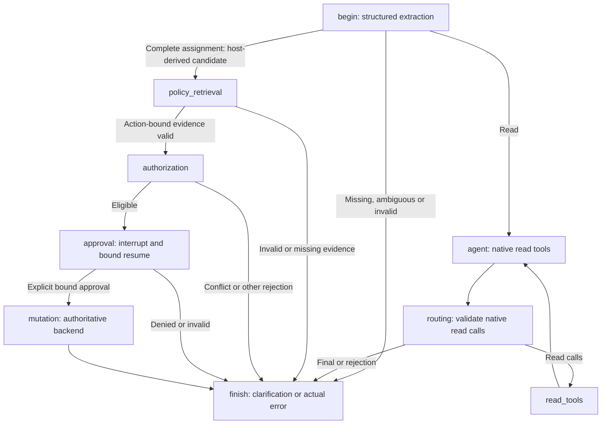

# Deterministic assignment dispatch: implementation and verification

This implements the [architecture assessment](deterministic_assignment_routing_assessment.md). A fully registered assignment now reaches the existing policy/authorization workflow without asking Gemini to submit an `assign_lead` tool call. All mutation gates remain. No Gemini calls were made during implementation or verification.

## 1. Graph routing

`begin` still makes one structured request-normalization call using the existing model and strict `RequestIntent`. Only a complete `first_assignment` with explicit positive integer lead/destination IDs can become an `AssignmentIntent`. The host supplies the operation ID. Extraction is untrusted request data, not permission or approval.

The host calls `AssignmentIntent.action()` to derive the exact strict assignment payload, records `action_source="host"`, and routes directly from `begin` to the existing `policy_retrieval` node. Deriving in `begin` rather than adding a host branch to native-call `routing` keeps the change smaller and separates the two execution paths. No new graph nodes or model stages were introduced; all nine existing nodes remain registered.



The native read model is bound to `search_leads`, `get_lead_details` and `retrieve_policy`. Their execution, metadata, ToolMessages, ranking order and bounded loop remain intact. The typed `assign_lead` interface and its non-writing callable body remain available for compatibility/tests, but are not bound to the read model. Any unexpected native assignment proposal is still schema-checked and rejected; it cannot create a candidate or enter policy retrieval. The unused `routing → policy_retrieval` edge was removed.

## 2. State and exact-action checks

`assignment_intent`, `candidate_action`, `pending_action`, `resolved_action`, policy references, operation ID and messages retain their roles. `action_source` replaces the obsolete `recovery_used` and `recovery_pending` fields. `pending_call_id` is null for host-dispatched assignments; no replacement native call ID is invented.

The local `exact_host_action` check requires:

- Host provenance and no claimed native call ID.
- Candidate/pending action equality with the strictly validated registered intent's `.action()`.
- The action's request key matching the current host operation ID.

It runs at policy entry and before authorization, approval and mutation. Candidate changes at policy entry return explicit incomplete status rather than inventing a policy decision. After valid evidence, a changed action/provenance fails closed. The independent finish guard still requires an authoritative disposition for the exact registered action; successful reads or model prose cannot satisfy that obligation.

Public graph input remains limited to messages and a host operation ID. Chat text cannot provide candidate state, actor permissions, host provenance or approval envelopes. Actor identity continues to come exclusively from the configured host/service, including an explicitly selected fictional demo identity.

## 3. Provenance and message protocol

Host dispatch emits a real `tool_selected(tool="assign_lead", source="host")` event when the application selects that logical operation. This is not an LLM tool call or an execution of the proposal-only callable. Native selections use `source="model"`. Printable traces also include source on these selections and host approval/mutation activity.

Host assignment results remain structured application results in state and are rendered into the existing verified final answer. Policy rejection, authorization rejection, denied approval and mutation results append **no ToolMessages** for host dispatch. Read ToolMessages and replies to rejected real native calls retain their actual provider call IDs. No AIMessage with an invented tool call is constructed.

`ApprovedAssignment` now has explicit `source` and a nullable `tool_call_id`. Strict validation requires host envelopes to have no native call ID and legacy model envelopes to have one. The graph creates only host envelopes and checks provenance again before mutation. Compatibility for directly constructed legacy model envelopes does not grant execution rights: the backend still requires valid signed consent and matching action/actor/operation.

Provenance is bookkeeping, not a new authorization mechanism. No host dispatch reference is substituted for a native tool-call ID. Operation identity remains the existing real host operation key and signed action fingerprint.

## 4. Existing safety gates remain authoritative

The action-bound evidence, authorization and assignment-service implementations were not changed.

1. `policy_retrieval` reads verified CRM fields, retrieves for the exact candidate, validates canonical citations and applicability, and binds compact evidence to the action fingerprint. Missing evidence, invalid citations, unavailable retrieval and corpus problems use the existing authoritative rejection paths.
2. `authorization` checks the current actor and existing completed operation, then uses `AssignmentService.propose` for deterministic eligibility and the signed proposal context. Ownership, territory, intake, certification, availability, VIP restrictions and capacity **25** retain their existing rules.
3. `approval` revalidates evidence, action and signed context before `interrupt()`. Only a strict explicit `approved=True` decision bound to actor, operation, action fingerprint and challenge can produce signed consent. It uses the same `Command(resume=...)` behavior. User/model claims of approval have no effect.
4. `mutation` checks evidence, exact intent and the approved host envelope, then delegates through `CRM.assign_lead` to the single authoritative service.
5. The service still uses a short `BEGIN IMMEDIATE` transaction, rechecks mutable eligibility/capacity, conditionally updates only a null owner, verifies the row, and commits owner/audit/idempotency result atomically. Replay, payload mismatch, rollback, locking and uncertain post-commit retries retain their existing behavior.

Nothing writes or holds a transaction during extraction, policy retrieval or human approval. Policy evidence never becomes authorization. Already-assigned leads, including same-owner requests, still conflict; no reassignment or override workflow was added.

## 5. Ambiguity, cancellation, changes and retries

Missing/ambiguous IDs, names without explicit IDs, multiple alternative actions and malformed structured output still clarify without guessing or dispatching. Read-subject IDs do not create assignments. Hypothetical and negative requests remain read/clarification according to structured extraction; there is no production keyword router.

While approval is pending, another `chat` request is rejected. The user can explicitly deny the current request through the existing approval API before starting a different intent. Denial leaves no approved action or uncertain-retry capability. Reusing an old approval for a new dispatch fails its binding. A changed target under the same registered operation key requires clarification.

New intents keep their host-generated keys. Explicit same-operation retries preserve the original key. A committed duplicate returns `already_completed` without another mutation or audit entry; post-commit uncertainty is resolved using the existing consent/key retry path. No new key or approval is silently generated for a retry.

Checkpoint storage remains in memory. This change does not add durable sessions or migrate pending native-proposal checkpoints. Such an old envelope cannot acquire host provenance or bypass binding checks; missing/mismatched state fails closed. Complete or deny pending work in its original process, and retain original operation IDs when resolving committed outcomes after restart.

## 6. Why proposal recovery was removed

All valid assignments now leave `begin` for policy retrieval before entering the native loop. Incomplete assignments finish for clarification. The remaining native loop handles reads and rejects assignments. Therefore no legitimate assignment path needs a tool-free final or failed advisory read to request another proposal.

The recovery flags, invocation-only prompt, scheduling branches and native proposal-to-candidate conversion were removed after confirming this topology. The exact-action finish invariant remains. The read loop still permits the configured maximum model steps; the default is eight, plus one normalization request. A complete assignment uses one logical model request for extraction and zero native-loop requests. Bounded SDK/provider retries remain separate from logical model calls.

## 7. Evaluation semantics and unchanged contracts

The original 30-scenario dataset, expected outcomes, required/prohibited events, ordering, approvals, fault modes and database assertions were preserved. Legacy scripted native assignment responses remain in that dataset but are not consumed on host-dispatched assignments. The independent scripted normalizer still supplies request extraction; it does not authorize or mutate anything.

`correct_tool_selection` retains the application operation-selection contract and validates exact assignment arguments. Reports now explicitly distinguish:

- `host_selected_tools` and aggregate `host_dispatched_actions`.
- `model_selected_tools`, containing explicitly model-sourced selections.
- `model_tool_selection`, applicable to trials with an observed native-loop response or native selection/rejection. A completed read response omitting a required tool counts as failure even with zero selections. Host-only assignments have null model-selection metrics, not artificial LLM successes.

The safety grader additionally rejects a host dispatch without a preceding matching registered intent under the same operation reference. Existing authorization/evidence/consent/transaction partial-order checks remain intact. Historical results lacking these new metrics/provenance are not relabelled. Resumed aggregation excludes unavailable new measurements rather than fabricating them.

Manifests record host dispatch, zero proposal-recovery attempts and one maximum logical extraction call per complete assignment turn. Available token usage is still measured from actual responses; absent usage remains null.

## 8. Actual verification and artifacts

Final full suite: **389 passed in 48.21 seconds**. The new host-dispatch file adds 22 cases; expanding saved-failure coverage adds three cases, and one additional case prevents omission failures disappearing from model-selection metrics: 26 more tests than the preceding 363-test suite.

The first integration run had 37 failures because old tests expected proposal consumption/recovery or the old call counts. Those tests were adapted to exercise the same safety properties under host dispatch. Malformed and mixed native-call tests now use read turns so the unexpected proposals are actually observed. Provider-before-assignment tests inject failure at extraction, the only model phase on that branch. Prompt-injection testing still checks real policy hydration on a read turn and authoritative assignment rejection afterward. A test collection error from using pytest's reserved parameter name `request` was corrected before final verification. The final complete run above passed.

Additional coverage includes host dispatch with zero native invocations/messages/IDs; A08/P01/P03/F03 using a model that raises if invoked after extraction; invalid actors; explicit approvals accepted/denied; candidate/key/provenance corruption; forged envelopes; same-key changed actions; cancellation; old-approval replay; strict/ambiguous extraction; public-input injection; duplicates; and all prior transaction/concurrency/idempotency checks.

| Evaluation | Observed result | Artifacts |
| --- | --- | --- |
| Unchanged 30 scenarios, two scripted trials each | **60/60** all-contract passes; zero provider calls | [Report](stage4_runs/host-dispatch-scripted-final/report.md), [JSON](stage4_runs/host-dispatch-scripted-final/results.json), [trajectories](stage4_runs/host-dispatch-scripted-final/trajectories.jsonl) |
| All 30 scenarios with actual cached hybrid retrieval, offline | **30/30** all-contract passes; zero provider calls | [Report](stage4_runs/host-dispatch-hybrid-final/report.md), [JSON](stage4_runs/host-dispatch-hybrid-final/results.json), [trajectories](stage4_runs/host-dispatch-hybrid-final/trajectories.jsonl) |
| A03/A08 historical native response plans supplied but never consumed | **2/2** all-contract passes; no approvals or writes | [Report](stage4_runs/host-dispatch-legacy-patterns-final/report.md), [JSON](stage4_runs/host-dispatch-legacy-patterns-final/results.json) |

The single-trial benchmark records **53 logical model calls**, compared with 75 before host dispatch: 32 normalization calls and 21 read-loop calls. Two fixture follow-ups explain why normalization exceeds 30. It records 22 host action selections, 12 model tool selections and one deliberately injected F01 timeout. Model tool-selection applicability is 9 trials, all passing; authorization and citation metrics each apply to 18 trials, all passing. The two-trial run doubles these counts. Scripted token metrics are null.

Actual cached-hybrid trajectory examples:

```text
A08: 6  tool_selected assign_lead, source=host
     policy_retrieval → evidence validated → authorization
     15 authorization_result: conflict / lead_already_assigned
     finish; no approval or write

P01: 6  tool_selected assign_lead, source=host
     10 policy_evidence_rejected: policy_evidence_not_found
P03: 10 policy_evidence_rejected: policy_citation_invalid
F03: 10 policy_evidence_rejected: policy_retrieval_failed
     each finishes policy_blocked; no native loop, authorization or write

A01: 6  host selection
     15 authorization_result: eligible
     human approval interrupt and explicit bound resume
     26 approval_granted
     32 transaction_revalidated
     37 transaction_committed
     verified success
```

D01 has one commit followed by a matching idempotency hit on its duplicate turn. D02 commits before its deliberate response failure; retry returns `already_completed` from the single persisted result, with no duplicate audit/mutation.

Commands used:

```powershell
.\.venv\Scripts\python.exe -m pytest -o addopts='' -q --tb=short
.\.venv\Scripts\python.exe -m sales_copilot.cli agent-evaluate --trials 2 --eval-run-id host-dispatch-scripted-final
$env:HF_HUB_OFFLINE='1'
.\.venv\Scripts\python.exe -m sales_copilot.cli agent-evaluate --real-retrieval --eval-run-id host-dispatch-hybrid-final
.\.venv\Scripts\python.exe scripts/assignment_guard_replay.py --output-dir docs/stage4_runs/host-dispatch-legacy-patterns-final
```

These run IDs are now occupied; use new IDs/directories for later runs. Earlier verification runs from this implementation are also retained; the final runs include the model-tool-omission metric regression. Cached-model Hub warnings reflected deliberate offline mode, with both models loaded successfully; no fallback retriever or download was used. Current production source fingerprint is `96d4a97c1a11bb88b5504ded638b41b01c8960a108ee945a4b81312f81a41ffc`. The benchmark dataset remains `b67a4b655b0c3406c0676a2bcb8e90eb591402b85530bed782beb1d9763a0557`, and the policy corpus remains unchanged.

Preservation hashes verified all **375 previously existing protected files unchanged**, including production CRM records, `.env`, policies, benchmark expectations, prior evaluation artifacts and the authorization/assignment/evidence services. The previous live run remains 26/30; these local results are not a new Gemini success rate. Natural-language extraction can still fail or misclassify a request, and real retrieval/backend operations can still reject or fail. Deterministic routing removes the redundant proposal dependency while preserving those explicit outcomes.
