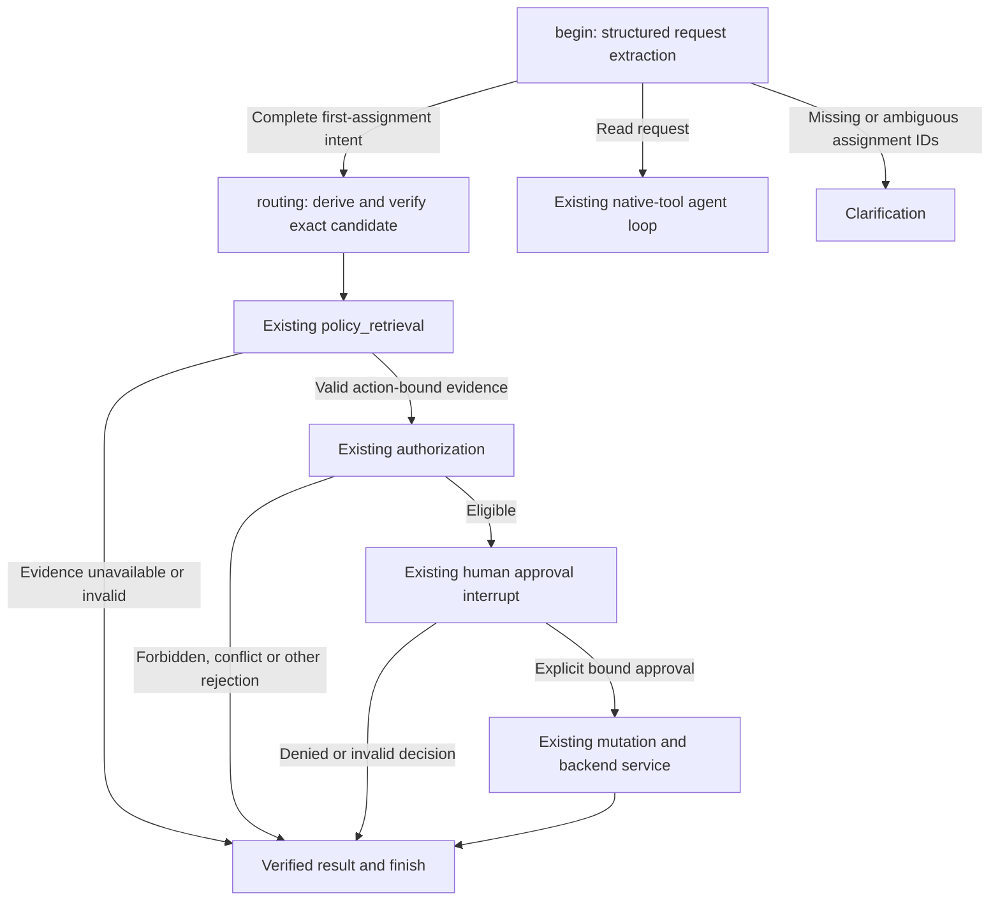

# Assessment: deterministic routing of complete assignment requests

**Recommendation:** once a complete first-assignment intent has been registered, derive the candidate action from that exact intent and route it deterministically into the existing action-bound policy-retrieval path. Requiring Gemini to generate the same action again adds a failure dependency without adding business authorization. This would remove the proposal-stage failure mechanisms observed in all four failed trajectories. It would not guarantee successful assignments or eliminate extraction, retrieval, authorization or database failures.

This is an assessment, not an implementation. No production code, benchmark labels, policies, CRM data, `.env` or existing evaluation artifacts were changed. No Gemini calls were made.

## Run and evidence

The latest completed saved run is [final-live-regression](stage4_runs/final-live-regression/report.md): **26/30 all-contract passes**. Its four failures are **A08, P01, P03 and F03**. The current production source fingerprint matches its manifest, `f1b5c3136742cadd4a06f84eb0c3ac6e70b561ba946987635c92b2b6a141dce5`. Each immutable trial record matches its corresponding aggregate result.

The full structured trajectories were inspected, together with current graph routing, state/schema contracts, policy retrieval, authorization, signed approval, transactional execution and evaluation grading. Saved traces omit raw model prose and the names/arguments of tool calls rejected before `tool_selected`; those details cannot be reconstructed.

| Scenario | Registered intent | Actual subsequent behavior | Expected backend outcome |
| --- | --- | --- | --- |
| [A08](stage4_runs/final-live-regression/trials/A08-1.json) | Lead 1 → agent 1 | Policy read, details read, tool-free final; recovery model request failed | `conflict / lead_already_assigned` |
| [P01](stage4_runs/final-live-regression/trials/P01-1.json) | Lead 21 → agent 1 | Missing evidence, then a non-assignment recovery tool call | `policy_blocked / policy_evidence_not_found` |
| [P03](stage4_runs/final-live-regression/trials/P03-1.json) | Lead 21 → agent 1 | Invalid citation, then a non-assignment recovery tool call | `policy_blocked / policy_citation_invalid` |
| [F03](stage4_runs/final-live-regression/trials/F03-1.json) | Lead 21 → agent 1 | Retrieval error, then a non-assignment recovery tool call | `policy_blocked / policy_retrieval_failed` |

Every intent already contained the required numeric IDs. None of these failures was caused by incomplete extraction, an exhausted tool-loop budget, an approval rejection or a transactional failure. No failed scenario changed leads, inserted audit rows or completed an operation. The full run's database postcondition metric is 30/30.

## What each trajectory proves

### A08: premature final followed by a failed recovery request

- Event 8: `first_assignment`, lead 1, agent 1 registered.
- Events 25 and 42: policy read succeeded; details confirmed `owner_id=1`.
- Event 50: Gemini completed a tool-free response. Its literal explanation was not saved.
- Event 54: the graph requested its one proposal recovery.
- Events 61–62: the recovery invocation failed with `model_request_failed`; HTTP status was null, with no identified quota category.
- Event 66: the graph reported `incomplete / assignment_not_validated`.

There was no native assignment proposal, dedicated `policy_retrieval` node or authorization decision. The saved classification is `model_error`, not rate limiting. The underlying provider/SDK failure is unspecified in the sanitized evidence; it cannot responsibly be labelled a 429, 503, quota exhaustion or a specific reasoning failure. The earlier tool-free final is observable, but its motive is not.

Deterministic dispatch after registration would avoid the subsequent four tool-loop invocations, including this failing recovery request. It must still retrieve fresh action-bound evidence before authorization. The ordinary details read does not itself authorize or resolve the request. The correct disposition is a conflict even though the requested agent is already the owner; unchanged-owner assignments remain unsupported.

### P01, P03 and F03: the recovery response did not propose assignment

The first advisory policy read returned the deliberately injected error. The previous fix correctly scheduled one recovery: event 25 for P01, event 26 for P03/F03. Each recovery request completed successfully with **one native tool call**: event 33 for P01, event 34 for P03/F03.

Routing rejected those calls with `assignment_proposal_required`: event 37 for P01, event 38 for P03/F03. In the actual code, that rejection occurs only after schema/call validation succeeds and the recovery response's selected tool is not `assign_lead`. Thus these were valid non-assignment tool calls, not another tool-free final, malformed assignment or provider outage. The rejected tool names were not persisted; claiming that any specific one was another `retrieve_policy` call would exceed the evidence.

The responses were blocked before execution, so `selected_tools` lists only the initial policy read. All three ended incomplete rather than reaching the dedicated gate and its required authoritative rejection. They are classified `agent_contract_failed`, with no failed LLM calls. The one-recovery limit worked; compliance with the recovery instruction remained probabilistic.

These are not permission to accept missing evidence, ignore invalid citations or hide retrieval errors. Those conditions are precisely why the existing policy gate must run and report its own rejection.

## Why deterministic dispatch addresses these failures

The application already holds a strict `AssignmentIntent` containing operation type, lead ID, destination ID and a host-issued stable operation ID. Its `.action()` method constructs the corresponding strict `AssignLead` payload. The additional native proposal currently has to reproduce that payload before the graph will request backend validation.

That duplication is a workflow dependency. Authorization comes from Python rules and host actor identity; approval comes from bound human consent; persistence comes from the transaction. An LLM tool-call envelope supplies none of those capabilities.

For a complete registered first-assignment intent, the proposed path is:

No model proposal, proposal-recovery request or advisory-read loop is needed on this complete-action branch. Native tool calling remains useful for read/search/ranking/policy questions. Ambiguous, hypothetical, negative or incomplete requests must not become assignments merely because IDs are present. The operation discriminator and existing strict extraction/clarification behavior remain necessary.

This routing is deterministic **after extraction**. It does not make Gemini's natural-language classification deterministic. Extracted slots remain untrusted request data, never permission or approval.

## Conditions for preserving every safety gate

| Existing invariant | Requirement for the deterministic branch |
| --- | --- |
| Exact requested action | Derive the candidate only from validated registered intent; verify equality with `intent.action()`. Retain same-key changed-target rejection and later envelope/action equality checks. Never accept arbitrary candidate state from chat input. |
| Stable operation identity | Keep the host operation key and authenticated/simulated host actor binding. Reuse the key for the same logical retry; create a new key only for a new intent. |
| Action-bound policy evidence | Enter `policy_retrieval` before authorization. Retrieve independently for the exact candidate; validate canonical references, corpus and action fingerprint. Invalidate prior evidence. |
| Fail-closed evidence handling | Preserve missing, irrelevant, forged, conflicting/stale and retrieval-error rejection behavior. Do not reuse advisory read results as authorization. |
| Deterministic authorization | Preserve `lookup_completed`, `service.propose`, identity/permission checks, first-assignment restrictions, territory, certification, availability, capacity 25 and all other current rules. |
| Human consent | Preserve `interrupt()`/`Command(resume=...)`, explicit strict `approved=True`, actor/action/operation/challenge binding, signed consent, expiration and replay rejection. No text claim can approve. |
| Transactional mutation | Preserve the single authoritative backend executor, `BEGIN IMMEDIATE`, mutable-fact revalidation, conditional null-owner update, affected-row check and SQLite confirmation. No locks or writes during approval. |
| Atomic effects and retries | Preserve atomic owner/audit/idempotency commit, payload fingerprints, same-key replay and conflict semantics, rollback and post-commit uncertainty handling. |
| Completion truthfulness | Resolve only the exact registered action using actual gate/service outcomes. Keep the independent finish guard and verified-results presentation. Reads and model prose cannot satisfy assignment completion. |
| Bounds | Keep the existing read-tool loop limit and at most one recovery on any remaining tool-driven fallback. The complete-action branch should not need that recovery or introduce additional model stages. |

The model-native proposal-equals-intent comparison becomes unnecessary on the host-derived branch because the candidate is constructed from that intent. Its **safety invariant** still applies at dispatch and every later binding. Any native proposal path retained must keep its current exact-action validation.

## Required plumbing: this is not just a new edge

`begin` currently routes only to `agent` or `finish`, and `routing` assumes its last message is an AIMessage containing native tool calls. A host-derived branch must explicitly handle a registered action without pretending that a model called a tool.

Current result plumbing also assumes a native call ID:

- `blocked()` and approval rejection create ToolMessages unconditionally.
- `ApprovedAssignment.tool_call_id` requires a nonempty string.
- Approval and mutation compare that identifier as part of the graph envelope.

These need a narrow distinction between an internal dispatch reference and an actual provider tool-call correlation. Results without a real native call must remain structured application results; they must not generate orphan ToolMessages or fake AI tool calls. This bookkeeping change must retain the existing signed action/actor/operation consent checks and envelope equality. It is not a reason to weaken consent validation.

Tracing must identify host dispatch truthfully. If `tool_selected(assign_lead)` represents actual host selection of the logical assignment operation, record its host provenance; do not count it as an LLM-generated tool call. The evaluator must distinguish application routing correctness from model tool-selection quality. Retain the original expected outcomes, ordering, prohibited events and database assertions. Do not edit historical trajectories or silently redefine them as successful host dispatches.

This remains a small orchestration/plumbing change around existing nodes and services, not a new planner, agent framework, permissions engine or mutation path.

## Offline check of the predicted dispositions

An isolated local probe used the unchanged evaluation fixture builder, `RetrievalFaults`, canonical `ScriptedRetriever`, real `retrieve_for_action`/`validate_action_evidence` and `AssignmentService.propose`. It supplied each scenario's declared exact action under a separate host key. It did not invoke a model, approve an action or call the write executor.

| Fixture | Evidence validation | Actual existing backend/gate result | Database unchanged |
| --- | --- | --- | --- |
| A08 | Passed | `conflict / lead_already_assigned` | Yes |
| P01 | Failed | `policy_blocked / policy_evidence_not_found` | Yes |
| P03 | Failed | `policy_blocked / policy_citation_invalid` | Yes |
| F03 | Failed | `policy_blocked / policy_retrieval_failed` | Yes |

**4/4 matched the unchanged expected dispositions.** The probe uses canonical scripted retrieval, not a new measurement of hybrid retrieval quality or Gemini behavior. It verifies that the existing gates can produce the expected outcomes once the exact candidate reaches them. It does not claim that the proposed graph branch has been implemented or passed an end-to-end benchmark.

## Assessment and next validation

Deterministic dispatch is preferable to adding stronger recovery prompts or more model attempts for these complete requests. The four saved trajectories used 14 logical model calls in total: four successful normalization calls and ten subsequent tool-loop/recovery calls, including A08's failed request. The proposed branch removes that second proposal dependency; actual future latency and pass rates would need measurement after implementation.

Before claiming the change works end to end, regression tests should route all four cases through the real graph with a model double that raises if any native proposal invocation is attempted. They should assert the unchanged expected rejection, exact-action completion and SQLite snapshots. Eligible cases must still pause before writes, then cover approval accepted/denied, changed actions, replay, unauthorized actors, metadata gaps, capacity/concurrency, idempotent duplicate keys and post-commit retries. Read-only and ambiguous requests must retain their existing behavior.

All four observed proposal-stage mechanisms would be avoided, conditional on the already successful intent registration and the same fixture/gate behavior. That is a supported architectural conclusion, **not a new 30/30 live result**. Intent extraction can still fail or misclassify, policy retrieval can fail, authorization can reject, humans can deny and SQLite can return conflicts or temporary errors. Those remain explicit outcomes. No live rerun or production implementation was performed for this assessment.
