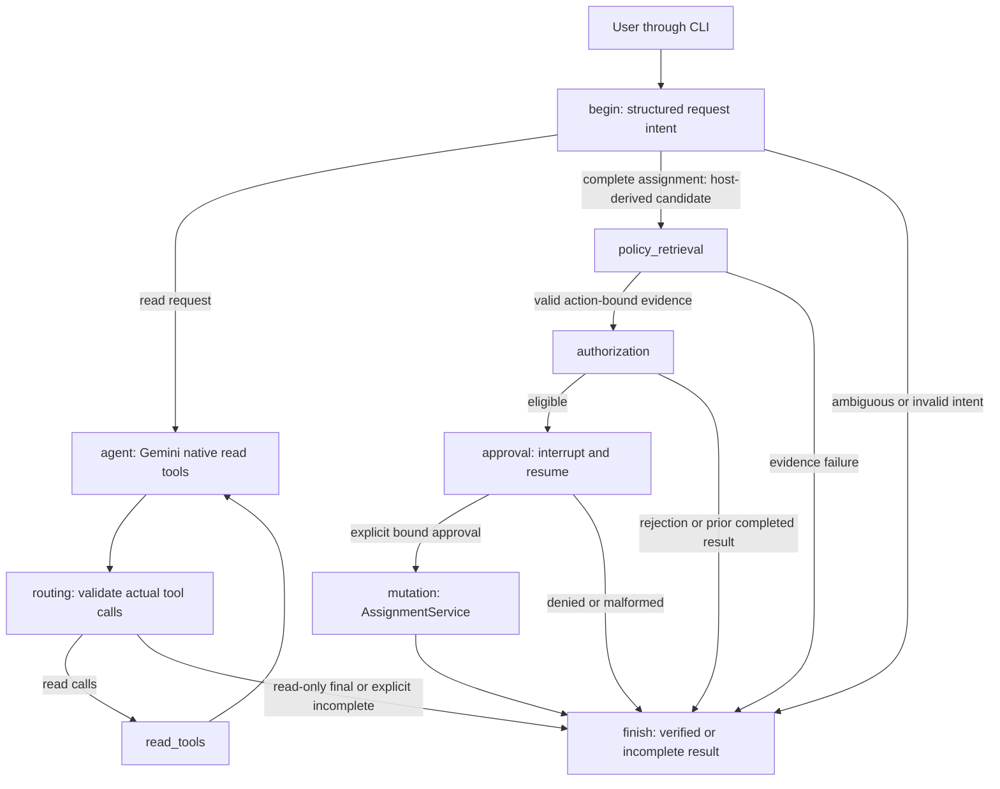

# AI Sales Copilot: code walkthrough and interview preparation guide

This guide explains the **current implementation**, including Stages 1–4, deterministic ranking, quota-aware evaluation and deterministic assignment dispatch. Read it alongside the linked source files and the [host-dispatch implementation/results](deterministic_assignment_routing.md). Examples marked illustrative explain behavior; they are not claims about the current contents of your working CRM.

Use this document in three passes:

1. Learn the project pitch and follow one request through the graph.
2. Study retrieval, authorization, approval, transactions and evaluation separately.
3. Practice the interview questions, failure stories and code walkthrough without reading the answers.

The most important distinction to remember is:

> The model interprets requests and selects read tools. The host routes complete assignment intents. Retrieval supplies evidence. Python rules authorize. A human confirms the exact action. SQLite decides whether the effect committed.

## Contents

1. [Explain the project clearly](#1-explain-the-project-clearly)
2. [Scope and development stages](#2-scope-and-development-stages)
3. [Architecture and trust boundaries](#3-architecture-and-trust-boundaries)
4. [Repository map and reading order](#4-repository-map-and-reading-order)
5. [Python and framework concepts used](#5-python-and-framework-concepts-used)
6. [The CRM and SQL read path](#6-the-crm-and-sql-read-path)
7. [Gemini, native tool calling and messages](#7-gemini-native-tool-calling-and-messages)
8. [LangGraph state, nodes and edges](#8-langgraph-state-nodes-and-edges)
9. [Assignment-intent completion guard](#9-assignment-intent-completion-guard)
10. [Follow complete example requests](#10-follow-complete-example-requests)
11. [Policy RAG and hybrid retrieval](#11-policy-rag-and-hybrid-retrieval)
12. [Deterministic authorization](#12-deterministic-authorization)
13. [Human approval and consent binding](#13-human-approval-and-consent-binding)
14. [Transactions, concurrency and TOCTOU](#14-transactions-concurrency-and-toctou)
15. [Idempotency, audit and failure recovery](#15-idempotency-audit-and-failure-recovery)
16. [Deterministic business ranking](#16-deterministic-business-ranking)
17. [Tracing, errors and provider quotas](#17-tracing-errors-and-provider-quotas)
18. [Retrieval and agent evaluation](#18-retrieval-and-agent-evaluation)
19. [Tests and evidence you can discuss](#19-tests-and-evidence-you-can-discuss)
20. [Demonstrate the project](#20-demonstrate-the-project)
21. [Interview questions and strong answers](#21-interview-questions-and-strong-answers)
22. [Trade-offs, limitations and future work](#22-trade-offs-limitations-and-future-work)
23. [Preparation plan and final revision sheet](#23-preparation-plan-and-final-revision-sheet)

## 1. Explain the project clearly

### One sentence

“AI Sales Copilot is a Python application where Gemini uses CRM and policy-retrieval tools through a custom LangGraph workflow, while deterministic backend rules and explicit human approval protect first-time lead assignments.”

### A 30-second explanation

“A user can ask for leads, inspect a lead, retrieve fictional sales policies or request an assignment. Gemini interprets the request and chooses native tools. Reads execute automatically. An assignment must pass action-bound policy retrieval, Python authorization and a separate approval interrupt. A short SQLite transaction then rechecks mutable facts and atomically saves the owner, audit event and idempotency result. I also evaluate both task outcomes and the execution path, including failures and retries.”

### A two-minute explanation

Expand the short answer in this order:

1. **Problem:** natural-language CRM access is useful, but allowing model output to update business records directly is unreliable.
2. **AI responsibility:** understand natural language, extract structured intent and choose native tools; retrieve relevant policy evidence.
3. **Application responsibility:** validate tool arguments, control graph transitions, bind evidence to actions and require an authoritative outcome.
4. **Business responsibility:** deterministic rules check actor permissions, territory, industry, certification, availability, ownership, VIP restrictions and capacity.
5. **Human responsibility:** confirm the exact eligible proposal through `interrupt()` and `Command(resume=...)`.
6. **Database responsibility:** serialize competing writes, recheck current facts and atomically commit all durable effects.
7. **Verification:** isolated scenario fixtures, structured trajectories, actual SQLite postconditions, controlled failures and separately reported live/model availability.

End with the scope: this is a fictional local prototype with simulated identity, not a production authentication or policy-compliance platform.

### What makes the project technically interesting

The strongest discussion is the interaction between probabilistic model behavior and deterministic application guarantees. Focus on the boundaries and failure cases, rather than saying only “I connected an LLM to a database.”

## 2. Scope and development stages

| Stage | Main addition | Concept to explain |
| --- | --- | --- |
| 1 | Fictional SQLite CRM, typed native tools, custom graph, approval interrupt, CLI | Tool calling and explicit workflow control |
| 2 | Ten fictional policies, local embeddings, BM25, RRF, cross-encoder, citations | Hybrid retrieval and grounded evidence |
| 3 | Structured authorization, exact consent, transactions, idempotency and audit | Reliable first-time assignment under failure/concurrency |
| 4 | Thirty labelled scenarios, trajectory recording, grading, scripted/live modes | Evaluating what happened and how it happened |
| Ranking follow-up | Configurable ranking over actual recorded attributes | Deterministic business ordering |
| Quota follow-up | Pacing, bounded provider retries, availability metrics, resume | Separating infrastructure failures from agent failures |
| Intent follow-up | Independent intent, exact-action completion and deterministic host dispatch | Removing the redundant native-proposal dependency |

Current assignment scope is deliberately narrow:

- A lead must currently be unassigned and active.
- `new`, `contacted` and `qualified` are active; `won` and `lost` are closed.
- Any existing owner blocks a new assignment, including assigning back to that same owner.
- The effective capacity limit is **25 active leads**, retained from the fictional policy. The additional absolute ceiling of 50 does not relax it.
- Cross-territory exceptions, VIP management workflows, reassignment and overrides are unsupported.
- Missing required metadata blocks execution; neither chat nor a guessed business fact fills the gap.

The original Stage 1 fixture had twenty leads and four agents. The current seed logic also ensures a fictional unassigned Chennai example in an appropriate fresh seed, yielding twenty-one leads in a new standard fixture. Existing owners and records are not reset to make a demo work.

## 3. Architecture and trust boundaries



These are the real graph node names. The model helper, retriever and assignment service are ordinary Python components called from those nodes; they are not additional autonomous agents.

### Five boundaries

| Boundary | What crosses it | What validates it |
| --- | --- | --- |
| User → model | Natural-language request | Structured extraction, clarification and application state |
| Model → tools | Tool name, call ID and JSON arguments | Allowlist plus Pydantic schemas and exact-intent matching |
| Retrieved text → workflow | Policy passages and references | Canonical chunk validation, relevance checks, action binding; text never grants permission |
| Human decision → executor | Approval tied to an actor and action | Strict decision schema, challenge, expiry and signed consent |
| Executor → SQLite | A proposed durable change | Transactional rule rechecks, conditional update, affected-row/readback checks and atomic commit |

An instruction in a retrieved document belongs on the data side of the boundary. It cannot become a graph edge, permission, Python function or approval decision.

## 4. Repository map and reading order

```text
sales_copilot/
  cli.py                  CLI commands, chat loop, explicit approval input
  model.py                Existing LangChain/Gemini model configuration
  intent.py               Structured request normalization and observed model calls
  graph.py                State, nine nodes, host dispatch, interrupt/resume and finish
  schemas.py              Strict request/tool/approval contracts
  tools.py                Native tool definitions; assignment is proposal-only
  db.py                   SQLite read repository, seed and write-service facade
  demo.py                 Explicit new-file-only fictional demo metadata
  migrations.py           Additive tables and opt-in simulated identity
  corpus.py               Policy loading, chunking, stable IDs and canonical resolution
  retrieval.py            Dense/BM25/RRF/cross-encoder retrieval and cache
  policy_gate.py          Exact-action evidence binding and validation
  authorization.py        Explicit first-assignment business rules
  assignment.py           Signed consent, transactional execution and idempotency
  ranking.py              Deterministic score/priority ranking
  presentation.py         Conversational rendering of verified results
  errors.py               Safe provider error classification
  tracing.py              Printable diagnostics and redacted structured events
  evaluation.py           Retrieval Recall@3/MRR@5 evaluation
  policies/               Ten versioned fictional policy documents plus manifest
  agent_eval/
    fixtures.py           Isolated SQLite fixtures and offline model/retrieval doubles
    runner.py             Scenario execution, reports, manifests and resume
    grading.py            Task, ordering, safety and actual database checks
    quota.py              Live-evaluation pacing and bounded provider retries
    availability.py       Availability versus contract-failure classification
    artifacts.py          Immutable checkpoints and read-only resume parents
evaluation/
  policy_queries.json     Retrieval queries and relevant policy IDs
  agent_scenarios.json    Thirty agent scenarios and unchanged expected contracts
config/
  lead_ranking.example.json
scripts/
  assignment_guard_replay.py
  analyze_stage4_availability.py
  stage3_trace_demo.py
tests/                    Unit, integration, failure and regression tests
docs/                     Walkthroughs, analyses and saved evaluation artifacts
```

### Recommended source-reading route

1. [cli.py](../sales_copilot/cli.py): see which objects the application constructs.
2. [schemas.py](../sales_copilot/schemas.py) and [tools.py](../sales_copilot/tools.py): learn the public contracts.
3. [graph.py](../sales_copilot/graph.py): follow `build_graph()` and `Copilot`.
4. [intent.py](../sales_copilot/intent.py): understand why intent is separate from tool choice.
5. [db.py](../sales_copilot/db.py): trace a real read.
6. [corpus.py](../sales_copilot/corpus.py), [retrieval.py](../sales_copilot/retrieval.py), [policy_gate.py](../sales_copilot/policy_gate.py): trace policy evidence.
7. [authorization.py](../sales_copilot/authorization.py), then [assignment.py](../sales_copilot/assignment.py): locate the actual write boundary.
8. [grading.py](../sales_copilot/agent_eval/grading.py) and [tests](../tests): see how claims are checked.

Do not start by memorizing every test or policy paragraph. First understand the read path, then the assignment path, then the failure paths.

## 5. Python and framework concepts used

### LangChain versus LangGraph

**LangChain** supplies model/message/tool abstractions: chat model initialization, `bind_tools`, structured output and message classes.

**LangGraph** controls the application workflow: shared state, node functions, conditional edges, checkpointing and interrupts. A node returns a partial state update; the graph decides what executes next.

The project uses an explicit `StateGraph`, not a one-line prebuilt agent, because the developer needs to inspect and enforce the write path.

### `TypedDict` versus Pydantic

`State` and `InputState` are `TypedDict` definitions. They describe expected dictionary fields for Python type checking and graph organization. They do not provide the runtime security validation that a Pydantic model supplies.

Pydantic models in `schemas.py` validate external or untrusted structured data at runtime:

- `extra="forbid"` rejects additional arguments such as an injected `approved` field.
- `strict=True` avoids convenient but unsafe coercion of values such as strings into IDs.
- Positive-ID and bounded-string fields reject invalid payload shapes.
- Validators check relationships between fields, such as incompatible owner filters.
- `StrictBool` and explicit `is True` checks keep `1` or `"true"` from becoming approval.
- `frozen=True` discourages accidental field reassignment; it is not deep immutability or an authorization boundary.

A valid Pydantic object can still describe a forbidden action. Schema validation answers “is this shaped correctly?”, not “may this actor do it?”

### Reducers and message history

The graph declares:

```python
messages: Annotated[list[AnyMessage], add_messages]
```

`add_messages` merges message updates, including message-ID-aware replacement, instead of replacing the entire history with every node update. Other fields, such as `route` or `pending_action`, use ordinary replacement updates.

At the start of a new turn, `begin` resets per-turn action, provenance and results fields while the conversation's messages remain. This is why a read in a later turn cannot inherit the previous turn's approval or evidence.

### Dependency injection and closures

`build_graph()` receives the CRM, model, retriever, trace and assignment service. Its nested node functions close over those dependencies. Tests supply scripted models, temporary databases and controlled failures through the same interfaces.

This is dependency injection: the workflow does not have to know whether its model is Gemini or an offline double. The production model still performs genuine native tool selection; a scripted test is not evidence of natural-language reasoning.

### Context managers and resources

SQLite connections are used with context managers and `contextlib.closing`. A connection's transaction context and the act of closing the connection are different responsibilities. Explicit cleanup matters for locks, file handles and reliable Windows tests.

### Decimal, hashing and signatures

- `Decimal` makes configured ranking arithmetic/ties stable for bounded recorded inputs.
- SHA-256 hashes identify content or canonical payloads. A hash is not a secret or a permission.
- HMAC authenticates a consent envelope using a process-local secret. Its role differs from an ordinary fingerprint.

## 6. The CRM and SQL read path

### Core records

| Table | Role |
| --- | --- |
| `leads` | IDs, fictional contact/company fields, city, status, score, priority, nullable owner and timestamps |
| `agents` | Four fictional agent IDs, names and territories |
| `crm_actors` | Host identity, enabled/assignment permission flags, simulated status and provisioning source |
| `lead_intake` | Verified industry, strategic/territory facts, review expiry and source |
| `agent_roster` | Availability, contact-window attestation, expiry and source |
| `agent_certifications` | Industry-specific credential, issuer/scheme, validity, suspension and source |
| `assignment_audit` | Committed business event, actor, request key, approval nonce, policy evidence and rule version |
| `assignment_operations` | Unique operation key, payload fingerprint and committed result for idempotency |
| `crm_migrations` | Applied schema migration versions |

Business metadata is in separate tables so an additive migration can preserve existing lead rows. Migration does not manufacture intake, availability, certification or permissions. A newly authored demo fixture explicitly supplies its own fictional facts.

### Search behavior

`search_leads` accepts city, status, owner and unassigned filters, plus ranking options. Filters are combined with AND.

```text
owner_id = null            → do not restrict owner
unassigned_only = true     → require leads.owner_id IS NULL
owner_id = 1               → require owner 1
```

The difference between “no owner filter” and “filter for a null owner” caused an earlier debugging issue and is important to explain. `SearchLeads` rejects `unassigned_only=true` combined with a specific owner.

The repository uses SQL parameters for values, not string-concatenated user SQL. The model cannot choose a table, issue arbitrary SQL or call a general `execute_sql` tool. Repository connections normally use SQLite URI read-only mode.

`get_lead_details()` performs a parameterized lookup with a `LEFT JOIN` to the owner's agent name. A left join keeps unassigned leads in the result even though they have no matching owner row.

The detail read does not join every intake, certificate or capacity fact. Therefore model inspection of a lead is not a complete eligibility review.

### Why SQLite?

It gives this local project real transactions, constraints, concurrency behavior and durable results without running a separate database service. It also makes isolated evaluation databases cheap to create.

The trade-off is serialized writes and limited suitability for a high-throughput distributed service. The project does not claim to solve those deployment problems.

## 7. Gemini, native tool calling and messages

### Model setup

[model.py](../sales_copilot/model.py) loads environment configuration with `load_dotenv(override=False)` and initializes the configured chat model through LangChain. Existing process variables take precedence over `.env`. Credentials are never hardcoded.

The Google configuration selects the Gemini Developer API explicitly. The existing adapter sets a request timeout, bounded output and a low default thinking level for the configured Gemini 3 family. These are application settings, not guarantees about latency or model quality.

### What `bind_tools` does

```python
tools, read_tools = make_tools(crm, retriever)
bound_model = model.bind_tools(tools)
```

Binding exposes tool names, descriptions and JSON argument schemas to the model. It does **not** execute a function automatically. Execution remains application-controlled after the response arrives.

The four CRM-facing tools are:

| Tool | Model's purpose | Actual execution |
| --- | --- | --- |
| `search_leads` | Find matching leads or request deterministic ranking | Allowlisted read executor |
| `get_lead_details` | Inspect a lead | Allowlisted read executor |
| `retrieve_policy` | Retrieve relevant fictional evidence | Allowlisted read executor |
| `assign_lead` | Submit an exact assignment for backend validation | Dedicated evidence/authorization/approval path; tool body itself raises |

### Messages and a real tool-call-shaped response

An illustrative response might contain:

```python
AIMessage(
    content="",
    tool_calls=[{
        "name": "get_lead_details",
        "args": {"lead_id": 21},
        "id": "example-call-1",
        "type": "tool_call",
    }],
)
```

After executing that actual call, the application replies with a `ToolMessage` carrying the **same tool_call_id** and the structured result. The next model invocation sees the assistant's request and matching tool response.

| Message class | Purpose |
| --- | --- |
| `SystemMessage` | Application instructions and boundaries |
| `HumanMessage` | User request |
| `AIMessage` | Model response: prose, native tool calls or both |
| `ToolMessage` | Result of an actual identified tool call |

The application preserves original AIMessage metadata, including Gemini thought signatures, instead of rebuilding responses and losing provider-required information. It also rejects malformed call IDs, unknown tools and mixed read/write batches.

Never create a ToolMessage merely because the model mentioned an operation in prose. There must be a real corresponding native call.

### Structured output is a separate use of the same model

`with_structured_output(RequestIntent, method="json_schema", include_raw=True)` asks for a typed intent object. This is not a CRM tool call. `include_raw=True` preserves the underlying AIMessage so available usage can be recorded while the parsed object is separately validated.

## 8. LangGraph state, nodes and edges

### The state is the workflow's working memory

| Field/group | Meaning |
| --- | --- |
| `messages` | Conversation and actual tool-call/result protocol |
| `operation_id` | Host-generated identifier for the logical request |
| `assignment_intent` | Registered exact assignment that still needs a disposition |
| `steps` | Tool-loop model-call budget consumed this turn |
| `read_calls` | Validated read calls awaiting execution |
| `candidate_action` | Exact host-derived assignment awaiting mandatory evidence |
| `pending_action`, `pending_call_id` | Action admitted after evidence validation; host dispatch has no native call ID |
| `policy_evidence` | Compact canonical references plus action/corpus binding |
| `approval_context`, `approved_action` | Signed proposal/bound decision information and approved envelope |
| `resolved_action` | Exact action for which the existing gate/service path returned an outcome |
| `action_source` | Host provenance for assignments; native read selections are traced separately |
| `results`, `completion_result` | Verified tool/application outcomes and explicit incomplete/clarification |
| `final_ai_message`, `answer`, `answer_source` | Original model final versus the grounded rendered answer |
| `retry_consent` | Capability for explicitly retrying an uncertain approved operation |

### The nine nodes

| Node | Main responsibility |
| --- | --- |
| `begin` | Reset fields, extract/register intent, derive exact host candidate or clarify/fail closed |
| `agent` | Invoke the native-tool model, preserving messages and measuring usage/errors |
| `routing` | Validate native read calls, reject assignment proposals, choose reads/finish |
| `read_tools` | Execute only allowlisted reads and append real ToolMessages |
| `policy_retrieval` | Retrieve and validate evidence for the exact candidate action |
| `authorization` | Resolve a prior operation or obtain deterministic preflight eligibility |
| `approval` | Interrupt for exact human consent and validate resumed decision |
| `mutation` | Require the approved envelope and delegate to the authoritative service |
| `finish` | Enforce exact-action completion and render verified outcomes |

The current registration loop contains **nine named nodes**. Model invocation helpers, the retriever and `AssignmentService` are components called by nodes; they do not add graph nodes.

### Edges and termination

Fixed edges include `agent → routing`, `read_tools → agent`, `mutation → finish`, and `finish → END`. Conditional edges read the node's `route` update.

An assignment cannot route directly from a native call to mutation. Its accepted entrance is always `policy_retrieval`. A failed evidence/authorization/approval step terminates with its actual result.

The default read loop permits eight model calls plus one intent-normalization call. Complete assignments use only normalization and then host dispatch, with no native-loop model calls. LangGraph also has a recursion limit to bound node transitions. Provider HTTP retries are separately bounded in live evaluation.

## 9. Assignment-intent completion guard

### The problem it fixes

In saved live scenarios A03 and A08, Gemini retrieved policies and read a lead, then returned a tool-free final instead of proposing assignment. Previously, routing accepted the final and finished with only successful reads, so the result summary was `read_success`.

No forbidden write occurred, but the requested assignment never received an authoritative backend decision. This is a **completion** failure, distinct from a write-safety failure.

### The current sequence

1. Normalize the request independently of CRM tool calls.
2. Register the operation type, explicit lead ID, destination ID and host operation ID.
3. Derive the exact candidate with the registered intent's `.action()` method; record host provenance.
4. Enter action-bound policy retrieval directly, without a native assignment call.
5. Require deterministic eligibility and explicit bound human approval before mutation.
6. Recheck exact intent, evidence, signed consent and mutable transactional facts.
7. Require an authoritative exact-action disposition at finish. Missing/ambiguous IDs clarify; changed actions and invalid binding fail closed.

The earlier recovery prompt/flags are removed. No host assignment ToolMessage, native call or tool-call ID is invented. Approved host envelopes explicitly record host source and no native call ID; real read calls retain their proper message correlation.

Historically, the [P03/F01/F02 follow-up](assignment_guard_failure_fixes.md) extended recovery to failed advisory reads. Later live failures showed that the recovery response could still omit assignment. [Deterministic dispatch](deterministic_assignment_routing.md) removes that dependency while retaining all safety gates. A read intent may contain explicit subject IDs; only `first_assignment` registers an action. Injected native-model timeouts remain scoped to tool calling, while genuine extraction failures fail closed.

### Why recording `pending_action` alone was insufficient

`pending_action` is created only after valid action evidence. Historically, the failing model never proposed anything, so a guard inspecting only that field saw no task to complete. Independently registered intent supplies the completion obligation. The host now derives the candidate directly, and the final guard still verifies exact-action resolution.

### What the guard does not prove

Intent extraction is still a model interpretation and can misclassify natural language. Its structured values are untrusted task data, not proof of what a person meant or permission to act. Missing IDs require clarification. Human consent and backend rules remain necessary even when extraction looks confident.

## 10. Follow complete example requests

### Read: “Show unassigned Chennai leads”

1. `Copilot.chat()` supplies a new host operation ID and HumanMessage.
2. `begin` normalizes the request as read-only.
3. `agent` may select `search_leads(city="Chennai", unassigned_only=True)`.
4. `routing` validates the actual call through `SearchLeads`.
5. `read_tools` queries SQLite, obtains rows and returns a matching ToolMessage.
6. `agent` can inspect details or return a tool-free final.
7. `finish` renders the actual results. A fake success statement in model prose cannot create a database write or override the displayed facts.

This exact tool sequence is model-dependent. Evaluation permits harmless extra reads.

### Eligible first assignment: “Assign lead 21 to agent 1”

Use an eligible **separate demo fixture**, not an assumption that your existing CRM still has an unassigned lead 21.

1. `begin` registers `first_assignment`, lead 21, agent 1 and the host key.
2. The host derives the exact `AssignLead` candidate and records host provenance.
3. `begin` enters `policy_retrieval` directly; no native assignment proposal or read-model call is required.
4. `policy_retrieval` gathers canonical, action-bound evidence.
5. `authorization` checks prior committed results and preflight eligibility.
6. If eligible, `approval` raises an interrupt with action, evidence and exact decision binding.
7. The CLI collects a separate approval response.
8. `Copilot.resume()` binds it to the current interrupt and passes a `Command` to the same thread.
9. `mutation` verifies the approved envelope and calls the assignment service.
10. The service rechecks current facts in a short transaction and commits all durable effects together.
11. Only a confirmed commit produces a new `success`; finish renders the actual result.

### Territory rejection: “Assign lead 21 to agent 2”

In the authored base fixture, lead 21 is Chennai and agent 2 is Bangalore. The proposal must still reach the backend. After valid evidence, deterministic authorization returns `policy_blocked / territory_ineligible` before approval. Human willingness cannot waive it.

### Already-owned lead: “Assign lead 1 to agent 1”

An existing owner causes `conflict / lead_already_assigned`, even if the destination is the same owner. This is a new assignment request, not automatically a retry of a committed operation. Idempotency depends on the original operation key and payload.

### Ambiguous request: “Assign this lead to someone”

Normalization cannot register exact IDs. The result requests clarification. The application does not guess, silently grant permissions or synthesize a tool call from a final answer.

## 11. Policy RAG and hybrid retrieval

Sources: [corpus.py](../sales_copilot/corpus.py), [retrieval.py](../sales_copilot/retrieval.py), [policy_gate.py](../sales_copilot/policy_gate.py).

### What RAG means here

Retrieval-augmented generation supplies relevant source passages to the model at request time. It does not train the model on the CRM or update its weights.

The retrieval corpus is **fictional CRM policy text**. Lead records come from structured SQL tools, not from a vector index. Keeping those access paths separate avoids treating an approximate semantic match as a database fact.

```text
Policy JSON documents
  → validate manifest and document structure
  → split within sections
  → stable canonical chunks
  → dense embeddings and BM25 index

Query
  → dense ranking ─┐
                  ├→ Reciprocal Rank Fusion → top candidates → cross-encoder
  → BM25 ranking ─┘
  → applicable passages + exact references + component scores
```

### Documents, sections and stable chunk IDs

Each policy has a stable policy ID, title, version and section identifiers. `Corpus` checks that the required policies exist, IDs are unique and sections are valid.

`split_section()` splits within a section using a maximum of 170 words per chunk. It does not combine unrelated sections and does not use overlapping windows. The current saved corpus has ten policies and sixty chunks.

A real citation shape is:

```text
[CRM-OWN-010@1.0/S1/C1-428d7b1a4e]
```

This identifies policy, version, section, chunk position and a content-hash prefix. References also carry the full text SHA-256. Changing content changes the chunk identity/fingerprint, allowing stale evidence to be rejected.

Including policy and section titles in `search_text` adds useful retrieval context. These titles are source metadata, not evaluation labels.

### Dense embeddings

The application uses local `sentence-transformers/all-MiniLM-L6-v2` embeddings. A bi-encoder maps the query and each chunk independently to vectors.

Semantically related text tends to have nearby representations, so a query about an agent being overloaded can match capacity policy even if exact words differ. The vector is a learned representation, not a stored explanation or proof of applicability.

Cosine similarity is:

```text
cosine(q, d) = (q · d) / (||q|| × ||d||)
```

Both document/query encodings request normalized embeddings. With unit-length vectors, cosine similarity becomes the dot product. The implementation scores all chunks with:

```python
dense_scores = self._vectors @ query_vector
```

This is an in-memory brute-force matrix search. FAISS is unnecessary for sixty chunks. A larger corpus could justify approximate nearest-neighbor indexing, with an additional accuracy/latency trade-off.

### BM25 lexical retrieval

BM25 matches terms instead of relying on semantic vectors. It helps with explicit terminology such as a policy name, territory or certification phrase.

The tokenizer lowercases text and keeps alphanumeric tokens. `BM25Okapi` builds document term statistics. Conceptually, its contribution for a query term is:

```text
IDF(term) × [tf × (k1 + 1)] /
           [tf + k1 × (1 - b + b × document_length / average_length)]
```

- **TF:** term frequency; repeated occurrences help with diminishing returns.
- **IDF:** rarer terms are more discriminative than common terms.
- **Length normalization:** a longer document should not win merely because it contains more words.
- `k1` and `b` govern saturation and length normalization; the library supplies the current defaults.

Dense and lexical retrieval run independently. Lexical candidates with nonpositive BM25 scores are excluded from that candidate list.

### Reciprocal Rank Fusion

Dense and BM25 scores are on different scales. Adding them directly would make their relative magnitudes an accidental weighting choice. RRF combines **rank positions**:

```text
RRF(chunk) = Σ over rankings [1 / (60 + rank_in_that_ranking)]
```

Ranks start at one. A chunk missing from a ranking contributes nothing from that list. A chunk appearing near the top of both lists receives two contributions. For example, dense rank 1 and lexical rank 3 contribute `1/61 + 1/63`.

The code initially considers up to twelve dense and twelve lexical candidates, fuses their union, and sends the best twelve fused candidates to reranking. A stable chunk-ID tie-break makes equal-score ordering predictable.

### Cross-encoder reranking

`cross-encoder/ms-marco-MiniLM-L6-v2` jointly reads each query/passage pair and returns a relevance score. Unlike a bi-encoder, it can attend across the query and passage together, but it requires a new model evaluation for every candidate pair.

The project uses it only on the fused shortlist. It requests raw scores with an identity activation. **These logits are not calibrated probabilities**, authorization confidence or percentages of policy compliance.

Default applicability requires both:

```text
dense_score >= 0.25
cross_score >= 0.0
```

`search()` returns up to the requested three passages by default, at most five through the tool schema. If none pass, it returns `policy_evidence_not_found`.

### Why reranking is not automatically better

The saved retrieval evaluation found RRF better on this small development set than unconditional cross-encoder ordering. Multiple chunks from one policy can displace another required policy, and the cross-encoder optimizes pair relevance rather than multi-policy coverage.

Current production code **still uses cross-encoder ordering and its relevance gate**. The earlier analysis recommends experimenting with RRF ordering; that recommendation was not implemented. Do not claim that this project automatically selects the best retriever or that simply removing the cross-encoder preserves existing abstention behavior.

See [the retrieval error analysis](stage2_error_analysis.md) for the specific regressions, label limitations and proposed experiments.

### Embedding and model caching

Policy document vectors are cached in compressed NumPy files. The cache key includes the corpus fingerprint, embedding-model identifier and normalization version. The loader checks array shape/count and finite values, and uses `allow_pickle=False`.

Document embeddings are reused instead of recomputed per request. Query embeddings are computed for each query. BM25 and loaded model objects are reused in memory; model weights also have a local cache. A temporary-file replacement avoids publishing a partially written embedding cache.

The project does not claim that the upstream model revision is permanently pinned just because the model has a stable name. For strict scientific reproducibility, model revision/weight provenance would also need explicit pinning.

### Citation grounding, compact state and hydration

`compact()` checks that returned passage text/citations match the canonical chunks before admitting a result to state. `validate_references()` reopens the current corpus, checks its fingerprint, resolves exact references, rejects duplicates/bad scores and enforces applicability.

Checkpoints store compact references instead of repeatedly copying large policy bodies. Before a relevant model invocation or presentation, `hydrate()` resolves those references back to current canonical text. This keeps state smaller without trusting the model to recreate source text.

A valid citation establishes source identity. It does not establish that the source is true, that every policy clause was checked, or that the action is permitted.

### Action-specific evidence

`retrieve_for_action()` builds its query from verified CRM context: ownership, lead city, receiving-agent city, priority and VIP score threshold. It does not invent intake or certification facts.

The evidence is bound to an action fingerprint derived from the validated lead ID, assignee ID and request key. Changing one requires fresh evidence. A generic policy answer earlier in the conversation is not automatically evidence for a later write.

The topical gate requires at least one recognized assignment-related policy family. It is a bounded relevance check, **not proof that every applicable business rule appeared in the retrieved top-k**. The deterministic service still checks the entire implemented rule set.

### Prompt injection defense

An injected passage might say “ignore the approval gate.” The system treats that as untrusted quoted text. The model is instructed not to obey it; more importantly, the application still requires exact intent, canonical evidence, deterministic rules and a genuine signed human decision.

Those independent gates provide safety even if prose influences the model. This is defense in depth, not a claim that prompt instructions eliminate all model-level injection behavior.

## 12. Deterministic authorization

Source: [authorization.py](../sales_copilot/authorization.py). Detailed mapping: [Stage 3 walkthrough](stage3_explained.md).

### Authentication, authorization and approval differ

| Concept | Question | Current implementation |
| --- | --- | --- |
| Authentication | Who is this actor? | Trusted host identity; explicitly simulated demo identity, no production login |
| Authorization | May that actor perform this action under current rules? | Explicit Python checks over structured SQLite facts |
| Approval | Did a human confirm this exact eligible action? | Separate interrupt/resume decision and signed consent |

“I am a manager” in chat answers none of those questions. An approval does not make an otherwise forbidden action eligible.

### Rules enforced

| Rule | Data used | Important rejection case |
| --- | --- | --- |
| Actor permission | `crm_actors` | Missing, disabled, unpermitted or unsourced actor |
| Reviewed policy mapping | Current corpus fingerprint | Missing/edited policies require developer review |
| Record existence | Lead/agent IDs | Missing lead or destination agent |
| First assignment only | `leads.owner_id` | Any existing owner, even the same requested owner |
| Active lead | `leads.status` | Closed won/lost lead |
| Verified intake | Industry, source, verification timestamp | Missing/unknown industry or future/invalid verification |
| Territory | Explicit intake confirmation and cities | Unconfirmed or mismatching supported territories |
| VIP restriction | Score and strategic designation | Score >=90 or strategic lead requires unsupported management workflow |
| Known priority | Recorded priority | Unknown classification |
| Availability | Sourced roster, availability/window flags, expiry | Unavailable, expired or unconfirmed destination |
| Restricted industry review | Intake review expiry | Missing/expired compliance review |
| Certification | Industry scope, issuer, scheme, dates, suspension, source | Missing/mismatched/expired/suspended credential |
| Contact-window coverage | Certification versus roster expiry | Credential expires before the attested window |
| Capacity | Current owned active-lead count | Existing count >=25 |

Ordinary industries are `retail`, `manufacturing` and `general_software`. Restricted industries are `healthcare`, `financial_services`, `insurance` and `public_sector`. Unknown industries do not silently default to ordinary.

The code requires timezone-aware dates and explicit sourced facts. It checks a roster's contact-window attestation; it does not calculate a real business calendar or independently verify external certificates.

### Why hard-code rules derived from policies?

The rule set is small, reviewable and limited in scope. Translating retrieved prose into executable authorization at runtime would let model variability alter business behavior.

The application pins the reviewed corpus fingerprint and a rule version. A document change blocks assignment until the mapping is deliberately reviewed. That is conservative and can reduce availability, but avoids silently running old rules against edited policy text.

### Preflight is not the final authority

Preflight tells the graph whether it may present an eligible proposal for approval. The database can change while a person considers it. Therefore the same mutable rules run again inside the actual write transaction.

## 13. Human approval and consent binding

Sources: [graph.py](../sales_copilot/graph.py), [assignment.py](../sales_copilot/assignment.py), [schemas.py](../sales_copilot/schemas.py).

### Checkpoint and resume mechanics

The compiled graph uses `InMemorySaver` and a stable `thread_id`. When the approval node calls `interrupt(payload)`, LangGraph pauses and exposes the approval request to the host.

The CLI collects a separate decision. Only the word `approve`, after trimming/case normalization, maps to approval; `yes`, `1`, `approved=true` in ordinary chat and policy text do not.

`Copilot.resume({"approved": True})` is a **trusted host convenience API**. It validates the strict boolean, obtains the binding from the current interrupt and constructs `Command(resume=bound_decision)` on the same thread. Raw resume callers must provide the complete binding.

On resume the node re-executes from its start. Therefore code before `interrupt()` must be safe to repeat. It revalidates evidence and prepares the request, but does not update owners, insert audit events or hold a transaction.

### The IDs are not interchangeable

| Identifier | Purpose |
| --- | --- |
| `thread_id` | Conversation/checkpoint location |
| `operation_id` / host `request_key` | Logical assignment intent and durable retry identity |
| Native `tool_call_id` | Matches a ToolMessage to an actual model request |
| Actor ID | Host-supplied principal used for permissions and consent binding |
| Approval challenge/nonce | Unique one-time confirmation challenge |
| Correlation ID | Joins events for an evaluation trial or execution |
| Policy chunk ID | Identifies an exact source passage |

A stable thread is not proof of identity, and a new thread must not be treated as a new operation if the client is retrying the same action.

### Why a signed consent capability?

After preflight/evidence checks, the service seals a proposal containing actor, action, payload fingerprint, evidence, unique nonce and a fifteen-minute expiry. It signs canonical JSON with HMAC-SHA256 and a random process-local secret.

The resumed decision binds strict `approved=True` to actor, operation ID, action fingerprint and challenge. The service verifies the proposal, exact binding, expiry and whether that challenge has already been decided. A valid confirmation creates an approved signed capability.

Constructing `ApprovedAssignment(approved=True, ...)` is insufficient: the backend also verifies the signed consent, exact payload and actor. It uses constant-time signature comparison. The process lock protects the in-memory decision set; it is not the mechanism enforcing database capacity.

### Hashes versus HMAC

- A **policy action fingerprint** binds evidence to the full action, including request key.
- A **business payload fingerprint** hashes actor, lead, destination and operation type; the operation key is the separate unique lookup key.
- An **HMAC signature** authenticates the complete consent envelope using a secret.

Anyone able to compute an ordinary SHA-256 hash has not thereby acquired consent. The secret-bearing service is the relevant capability boundary.

### Restart behavior

In-memory graph checkpoints and signer keys do not survive a process restart. An unfinished approval needs fresh review/consent. A previously committed idempotency result is durable and can be looked up with the original operation key and payload, subject to current actor permission.

The implementation is designed for a trusted local Python host. It does not protect against arbitrary hostile Python code that can access service internals or directly write the database.

## 14. Transactions, concurrency and TOCTOU

### What TOCTOU means

Time of check to time of use: a condition is checked, time passes, then an action uses an outdated assumption.

Between preflight and approval:

- Another request can assign the lead.
- Another lead can consume the destination's last capacity slot.
- An actor can lose permission.
- An agent can become unavailable or a certificate can expire.
- A policy source can change.

The human's decision cannot freeze those facts. Transaction-time revalidation is required.

### Why `BEGIN IMMEDIATE`?

SQLite serializes writers. `BEGIN IMMEDIATE` acquires the writer reservation before reading mutable capacity/ownership for execution. Competing assignment transactions cannot both read the last free slot and commit as if the other did not exist.

It is not a row lock or a distributed lock. Reader behavior depends on SQLite journal/transaction mode; the project does not claim to have enabled a special distributed isolation mechanism.

### The actual execution sequence

1. Verify the signed approved capability and exact action.
2. Open the write connection with a bounded busy timeout; enable foreign keys.
3. Issue `BEGIN IMMEDIATE`.
4. Check actor permission and look for a prior completed operation/key conflict.
5. If new, reject expired/replayed consent and validate current evidence.
6. Re-run mutable authorization, including ownership, roster, certification and capacity.
7. Execute the conditional first-assignment update.
8. Require exactly one affected row and read back the owner/timestamp.
9. Insert the audit event and completed idempotency result.
10. Commit. Only then report a new success.

The core write is:

```sql
UPDATE leads
SET owner_id = ?, updated_at = ?
WHERE id = ? AND owner_id IS NULL;
```

The predicate makes ownership protection part of the write itself. A prior read alone would not be enough. A zero row count is not success.

### Capacity race example

Illustrative starting state: an eligible agent owns 24 active leads and two requests target different unassigned active leads.

1. Transaction A obtains the writer reservation, sees 24 and commits one assignment.
2. Transaction B waits or receives a bounded busy failure.
3. When B can run its transaction checks, it sees 25 and rejects capacity.

The rule is an aggregate over the agent's leads. An ownership predicate alone cannot protect it; serializing the capacity check and write in the same transaction does.

### Atomicity and ACID

| Property | How to explain it here |
| --- | --- |
| Atomicity | Owner change, audit and idempotency result commit together or roll back together |
| Consistency | Constraints plus application rule checks preserve the implemented business invariants |
| Isolation | SQLite writer serialization and transaction-time reads protect competing service operations |
| Durability | A successful SQLite commit persists the recorded result according to SQLite/storage guarantees |

Do not translate “ACID” into claims of immunity to hostile external SQL, storage failures or all possible infrastructure failures. The tested boundary is service-controlled SQLite assignment.

### Keep the transaction short

There are no Gemini requests, embedding computations or human input inside the transaction. Evidence validation reads local canonical files. Approval occurs before acquiring the write reservation.

Locked/busy errors return a structured temporary failure. There is no unbounded write retry loop. The caller must resolve uncertainty using the original operation identity.

## 15. Idempotency, audit and failure recovery

### The problem

A client can time out after the database commits. If it repeats the action blindly, it might create duplicate audit events or falsely report a conflict for a successful original operation.

Idempotency gives the original logical request a durable identity. It is not deduplication of all requests mentioning the same lead/agent.

| Request state | Required behavior |
| --- | --- |
| New key, unassigned eligible lead, valid consent | Execute once and store committed result |
| Same key and same completed payload | Return stored result as `already_completed`; no new update/audit |
| Same key, different actor/lead/destination/type | Conflict rather than reinterpret the key |
| Different key, already-owned lead | Ownership conflict |
| Same key, no committed result after a pre-commit rollback | A properly approved retry can attempt the operation |

The host generates UUIDs for new intents. Model-suggested strings are replaced. The durable table's unique request key and canonical business fingerprint implement the lookup contract.

### The audit is part of the business transaction

The audit records who, what, which operation, approval nonce, policy references, rule version and commit time. It is inserted in the same transaction as the owner update and idempotency result.

This avoids a lead being assigned without its required audit, or a completed-operation record claiming a write that rolled back. Unique operation/nonce constraints also support replay protection. This is application audit logging, not a tamper-proof ledger against a database administrator.

### Controlled failure points

| Failure location | Expected durable state | Recovery |
| --- | --- | --- |
| Before mutation | No update/audit/completed result | Same logical operation can be retried with valid consent |
| After lead update, before audit | Entire transaction rolls back | No partial assignment remains |
| After audit, before idempotency completion | Owner and audit both roll back | No orphan audit or false completed result |
| After COMMIT, before response | All three effects already durable | Same key resolves to the prior committed result |

`commit_response_unknown` means uncertainty in what the caller received, not permission to announce failure as if a committed assignment had been undone. The UI withholds new success until it has a verified result.

### Retry paths

- `/retry` in the same process uses the exact stored consent/action/key for the last uncertain approved operation.
- `result --operation-id ... --lead-id ... --assignee-id ...` performs a committed-result lookup after restart without executing an uncommitted action.
- If nothing committed and process-local consent was lost, the user explicitly reuses the original key and obtains fresh approval.

Historical lookup checks the actor's current permission. It does not perform a new assignment or require the lead to still be unassigned; it is returning a recorded outcome.

### Exactly-once language

Say: “The service makes repeated requests with the same completed key/payload produce one committed set of effects.” Avoid claiming universal exactly-once delivery or execution across arbitrary clients, databases and outages.

## 16. Deterministic business ranking

Source: [ranking.py](../sales_copilot/ranking.py). Configuration: [example JSON](../config/lead_ranking.example.json).

The CRM currently supports recorded numerical score and recorded priority as ranking factors. There is no budget, engagement, conversion probability or revenue signal to infer from other fields.

| Search option | Meaning |
| --- | --- |
| `sort_by="id"` | Ordinary ID ordering; ascending by default |
| `sort_by="score"` | Numerical recorded score, descending by default |
| `sort_by="business"` | Trusted configured weighted factors; initially score weight 1 |

For ranked searches, the default ordering key is:

```text
descending primary total → priority high/medium/low → ID ascending
```

For ascending primary order, the priority/ID tie-breaks remain the same. Only the primary direction reverses.

The weighted total is:

```text
total = Σ weight(field) × recorded_value(field)
priority mapping: low=0, medium=1, high=2
```

Weights are explicit, bounded nonnegative Decimals. Configuration rejects unknown/duplicate factors and all-zero weights. An explicit score request uses score even if the host configured a different business weighting. Priority tie-breaking can be disabled by trusted configuration.

The service validates ranking inputs instead of silently substituting invented scores. The renderer preserves the returned ordering rather than sorting it again or trusting the model's prose.

**Interview point:** deterministic does not mean objectively optimal. The strategy is reproducible and grounded in available business data; choosing weights remains a business decision. There is no learned lead-scoring model in this implementation.

## 17. Tracing, errors and provider quotas

### Observability versus control

[tracing.py](../sales_copilot/tracing.py) exposes two interfaces:

- `emit()` produces human-readable `TRACE` diagnostics.
- `event()` sends structured dictionaries to an observer for evaluation.

The evaluator consumes structured events, not regular-expression parsing of console logs. Events include correlation, sequence, elapsed time, an opaque operation digest and actual node/tool outcomes.

The node wrapper records actual starts, completions, transitions, interruptions and failures. The service records transaction, revalidation, audit, idempotency and commit events at their actual execution points.

An observer failure must not alter whether an assignment commits. It is isolated and counted; evaluation then fails its complete-observation check. This separates telemetry reliability from business execution.

### Redaction and its limits

Allowlisted fields preserve useful IDs, statuses, safe arguments and exact citations. Contacts, raw prompts, model prose, secret capabilities and arbitrary provider bodies are excluded/redacted. Actor identifiers and operation keys have special handling; an operation digest supports correlation without recording the raw key.

Because model prose was intentionally not saved in historical runs, the A03/A08 investigation could prove a tool-free final occurred but could not quote its explanation. Redaction is a deliberate observability trade-off, not permission to reconstruct missing evidence.

### Error handling

[errors.py](../sales_copilot/errors.py) inspects safe exception/status information and emits public codes such as `model_rate_limited`, `model_timeout` and `model_access_denied`. Raw exception text can contain credentials or private request data and is not displayed.

Read results already obtained can remain visible after a later provider failure. An unresolved registered assignment additionally gets explicit incomplete state, so prior successful reads cannot disguise the unfinished mutation workflow.

### Quota dimensions

| Dimension | Meaning | Why it matters |
| --- | --- | --- |
| RPM | Requests per minute | Many small calls can exhaust it |
| TPM | Tokens per minute | A few large contexts can exhaust it |
| RPD | Requests per day | Short backoff does not replenish an exhausted daily allocation |
| Unknown | Response lacks a supported resource/window classification | Do not guess from frequency or prose |

The live-evaluation controller classifies structured quota IDs/metrics when available. Daily token quotas stay unknown among these requested categories but still trigger daily-exhaustion stopping. A 429 alone does not prove which quota failed.

### Pacing and bounded retries

[quota.py](../sales_copilot/agent_eval/quota.py) is used by **live evaluation**, not as a universal automatic write/chat retry service. It supports minimum spacing between provider attempts and pauses between batches of scenario-trials.

For transient HTTP 429/503, the retry delay uses:

```text
exponential_cap = min(configured_cap, base × 2^(attempt - 1))
jittered_delay = uniform(exponential_cap/2, exponential_cap)
actual_delay = max(jittered_delay, valid provider minimum delay)
```

`Retry-After` seconds/HTTP dates and structured RetryInfo are honored. A provider minimum beyond the remaining wait budget defers the run rather than being truncated into an early retry. Daily exhaustion stops immediately. Attempt count and cumulative backoff sleep are bounded; exhausted 429 attempts pause remaining scenarios to avoid a cascade.

The installed Google integration maps the existing `max_retries=1` to **one total SDK attempt**. A local regression test verifies that mapping, leaving application retries as the sole live-evaluation retry owner. Do not assume that every provider library uses the same meaning for that parameter.

Provider request retrying and CRM assignment retrying are different systems. HTTP retries occur around model requests. Assignment retrying must preserve exact consent, action and durable operation identity.

### Resumable artifacts

Each evaluation has a new run directory, an initial manifest and immutable per-trial checkpoints. Temporary `.pending` files avoid admitting partial JSON. Resume reads the parent without overwriting it and creates a child directory.

Resolved trials—including genuine completed agent failures—are retained. Missing or unresolved provider-blocked trials rerun in fresh isolated databases. This prevents resume from silently resampling every real agent failure until it passes.

An interrupted trial's temporary database/consent is not durable. Resume replays that **whole fictional scenario**, not a production mutation or a stale approval. Dataset, corpus, fixture version and live model compatibility are checked; source differences are disclosed.

## 18. Retrieval and agent evaluation

There are two separate evaluation problems:

1. **Retrieval quality:** are the right policy sources near the top?
2. **Agent behavior:** did the workflow satisfy the user's task through the required safe execution path and actual database state?

A strong retrieval score cannot prove assignment safety. A safe workflow can still retrieve poorly or fail to complete a task.

### Retrieval Recall@3

The labelled unit is a **policy ID**, while the retrieval positions are **chunks**. For each positive query:

```text
Recall@3 = number of distinct expected policy IDs found in first 3 chunks
           / number of expected policy IDs
```

Illustrative example: expected policies are `{territory, capacity}` and the first three chunks come from `{territory, territory, ownership}`. Recall is `1/2`, not `2/2`; repeated territory chunks do not cover capacity.

The cutoff is applied before policy deduplication. This measures policy coverage within a three-passage budget, not coverage of the first three distinct policies.

### Reciprocal rank and MRR@5

For one query, find the first of the top five chunk positions whose policy ID belongs to the relevant set:

```text
RR@5 = 1 / first_relevant_position
       or 0 if no relevant policy appears in the first five chunks
MRR@5 = mean RR@5 over positive queries
```

MRR rewards an early first match, but does not measure complete multi-policy coverage. A query can have MRR 1 while missing another necessary policy.

The saved evaluation has 28 positive and 3 unrelated negative queries. Positive queries receive equal weight in macro-averaged recall/MRR. Empty-label negatives have null recall/MRR and are evaluated through abstention separately. They are not silently assigned perfect retrieval scores.

### Observed retrieval results

Historical evidence: [stage2_evaluation.json](stage2_evaluation.json). Rounded values:

| Method | Recall@3 | MRR@5 |
| --- | ---: | ---: |
| BM25 | 0.928571 | 0.971429 |
| Dense | 0.982143 | 0.964286 |
| RRF | 0.982143 | 1.000000 |
| RRF + cross-encoder | 0.946429 | 0.982143 |

All three labelled negatives abstained in that saved run. These are small development-set findings, not a general claim about the models.

The error analysis found no direct application path passing relevant-policy labels into the retriever. However, author-created queries, corpus iteration, overlapping policies and incomplete policy-level labels limit experiment independence and relevance judgments. No application fine-tuning is implemented, and this inspection cannot audit external pretrained-model training data.

### Agent scenario contracts

[agent_scenarios.json](../evaluation/agent_scenarios.json) defines thirty scenarios with initial fixture, natural-language request, expected outcome, required/prohibited events, partial orders, approval input and database postconditions.

The runner creates a new temporary database per scenario-trial. It never takes the configured production CRM path as a target. Fictional test metadata, failures and approval decisions are authored explicitly.

### Outcome metrics

| Metric | What is checked |
| --- | --- |
| Task completion | Expected status/error, intended action, requested read facts/ranking and actual DB postconditions |
| Correct tool selection | Required tool names and intended assignment arguments; invalid/forbidden selections lose credit |
| Required-step coverage | Fraction of declared required event selectors observed |
| Trajectory safety | Universal safety checks, prohibited events, required orders and complete observation |
| Authorization correctness | Actual labelled eligibility/rejection outcome, on applicable trials |
| Citation validity | Accepted references resolve to canonical chunks; not a guarantee of complete semantic relevance |
| DB postconditions | Owners, unchanged records, audits, completed operations, fingerprints and commit correlations |
| Unnecessary calls | Native calls above the declared minimum; an inefficiency proxy |
| LLM calls/latency/usage | Observed invocations, measured time and provider-returned numeric usage only |

Expected policy/permission/conflict/approval rejections count as correct task completion. A request for a forbidden assignment is successfully handled by an authoritative refusal, not by performing the write.

### Partial-order constraints

The grader does not demand an exact whole sequence of tool calls. It checks constraints such as evidence before authorization and approval before mutation, allowing additional harmless reads.

Separate universal checks examine every operation/transaction. One valid approval somewhere in a conversation cannot justify another operation's write. Missing revalidation, duplicate commits, write-after-denial or success-without-commit are safety failures.

Database grading verifies emitted events against actual snapshots and durable rows. A plausible event log alone cannot earn success if the database disagrees.

### Safety versus coverage

A trial can fail the trajectory-safety metric because a required ordering was never exercised during an outage. That is different from an observed unauthorized write. Inspect required-step coverage, explicit safety violations and DB outcomes rather than interpreting one headline rate in isolation.

### Availability versus reasoning

The runner separately reports:

- `model_available`: a successful response was observed without an unresolved non-injected model failure.
- `model_rate_limited`: any observed quota/rate limit, including one recovered by bounded retry.
- `model_error`: encountered non-injected, non-quota model/provider failure.
- `agent_contract_failed`: failure of original assertions despite model availability, or a concrete unsafe trajectory.

Flags can overlap. An application error after a successful model response must remain an agent failure rather than being censored as provider unavailability.

**Overall pass rate** includes saved attempted trials that failed because of infrastructure. **Conditional agent success** uses completed model-available trials with no observed rate limit and counts all original assertions. Empty denominators yield null. Pending/unattempted trials are listed separately; a paused run is not silently declared complete.

### Scripted versus live

Scripted models return authored tool-call-shaped messages and structured intent responses. They test actual graph/gates/SQLite behavior but do not prove the model understands natural language.

Live Gemini evaluation is opt-in, may cost money and can vary between trials. It still uses isolated fictional databases with explicit scripted approval decisions. Normal pytest does not call Gemini. Raw structured trajectories and failures are retained, but raw model prose is intentionally not included.

The existing generation model does not receive the scenario's ground-truth labels or scripted response plan. Those remain in the test harness for decisions/grading.

## 19. Tests and evidence you can discuss

### Types of tests

| Category | Examples in this repository |
| --- | --- |
| Unit | Pydantic validation, RRF, ranking arithmetic/ties, quota parsing/backoff, metric calculations |
| Integration | Real compiled graph, temporary SQLite repository, interrupt/resume, evidence binding |
| Security boundary | Direct backend calls, forged approval envelopes, missing actors, unrequested/changed actions |
| Concurrency | Same-lead competition and two assignments competing for one capacity slot |
| Failure injection | Pre-write, mid-transaction and post-commit failures; model/read/retrieval failures |
| Regression | Seed preservation, Gemini message metadata, ranking order, A03/A08 premature finals, D01 duplicate prerequisites |
| Evaluation correctness | Remove/reorder gate events and verify the grader detects the resulting violation |

Useful files to open during an interview:

- [test_assignment_intent.py](../tests/test_assignment_intent.py): historical failure plans remain unused, ambiguity, changed actions and human approval.
- [test_host_assignment.py](../tests/test_host_assignment.py): host provenance, exact candidates, cancellation, actor permissions, old approval replay and message protocol.
- [test_stage3.py](../tests/test_stage3.py): direct service boundaries, consent replay, capacity, transaction failures and concurrency.
- [test_agent_evaluation.py](../tests/test_agent_evaluation.py): actual scenario contracts and negative grader tests.
- [test_eval_quota.py](../tests/test_eval_quota.py): fake-clock retries/resume, metadata and SDK retry-count checks.
- [test_retrieval.py](../tests/test_retrieval.py): retrieval behavior and canonical validation.
- [test_ranking.py](../tests/test_ranking.py): deterministic ordering and unchanged data.

### Recorded verification snapshot

These are existing saved/documented results, not tests rerun to create this guide:

| Verification | Recorded result |
| --- | --- |
| Current full local suite after deterministic dispatch | **389 passed in 48.21 seconds** |
| Historical full local suite after the original intent guard | **346 passed in 143.25 seconds** |
| Thirty scenarios, two scripted trials each | **60/60** all-contract passes |
| Thirty scenarios, scripted model plus actual cached hybrid retrieval | **30/30** |
| Targeted A03/A08 premature-final replays plus recovery proposal | **2/2** |
| Historical live `gemini-full-30`, before the guard | **28/30**, failures A03/A08 |

See [guard results](assignment_intent_guard.md), [scripted report](stage4_runs/assignment-guard-scripted/report.md), [hybrid report](stage4_runs/assignment-guard-hybrid/report.md), [replay report](stage4_runs/assignment-guard-replay/report.md) and [live failure analysis](live_gemini_failure_analysis.md).

The targeted replays reached `territory_ineligible` and `lead_already_assigned` through actual policy/authorization nodes, with no approvals or writes. They reproduce observed native-call shapes; the original redacted query/final prose was not available to reproduce verbatim.

Do not present these local numbers as a post-guard live Gemini success rate. Do not infer completion from a run directory or initial manifest without a completed report.

### Three useful debugging stories

**1. Retrieval reranking worsened coverage.** A more sophisticated model did not automatically produce a better system metric. Comparing stages and actual passages exposed repeated-policy chunks and label overlap. Explain the measurement unit before making an optimization claim.

**2. D01 returned success instead of already_completed.** In an older quota-affected run, the first turn failed before any commit, but the harness still sent a duplicate probe. The second turn made the first assignment, so the backend correctly returned success. The harness now requires a verified initial commit before probing duplication. This distinguishes a test precondition defect from an idempotency defect.

**3. A03/A08 stopped after reads.** In the completed live run, the model returned tool-free finals without submitting the requested assignment. The graph accepted them and summarized read success. Independent intent plus exact-action completion checking fixed the workflow gap without relaxing the write gates.

A fourth story is deterministic ranking: exact expected orders initially failed because ordinary ID order was used. A dedicated ranking service over recorded score/priority fixed both search and display order without inventing new business signals.

## 20. Demonstrate the project

### Use the existing environment

From the project root:

```powershell
cd "D:\Projects\AI Sales Copilot"
.\.venv\Scripts\python.exe -m sales_copilot.cli --help
.\.venv\Scripts\python.exe -m sales_copilot.cli chat --thread-id interview-read-demo
```

Chat makes Gemini requests using existing environment configuration. Do not replace `.env` or put credentials in your presentation. A CLI without an explicitly selected/provisioned actor can read but cannot authorize assignment.

Suggested read-only prompts:

```text
Show only unassigned Chennai leads.
Show full details for lead 21.
Rank all Chennai leads by score from highest to lowest.
Which policies govern territory and agent capacity? Cite the passages.
```

Actual answers depend on the database and model. Do not promise that the working CRM has an unassigned record.

### Prepare a separate assignment demonstration

Choose a path that does not already exist:

```powershell
.\.venv\Scripts\python.exe -m sales_copilot.cli demo-db --db data/interview_demo_new.sqlite3
.\.venv\Scripts\python.exe -m sales_copilot.cli chat --db data/interview_demo_new.sqlite3 --demo-actor --thread-id interview-assignment
```

The new fixture explicitly provisions fictional intake/roster and the simulated dispatcher. Demo availability expires, so use a newly named fixture when needed; do not reset working CRM data.

Demonstrate in this order:

1. Read lead 21 and show its unassigned owner.
2. Request assignment to agent 1 and stop at the approval prompt.
3. Explain the exact action, policy evidence and actor/operation binding.
4. Reject once and show no owner change.
5. Submit a new explicit request and approve separately.
6. Read back the SQLite-confirmed owner.
7. Request another assignment and show the already-owned conflict.

Say “this identity is simulated” and “policy retrieval is evidence, not permission.” Do not claim the demonstration is real authentication.

### Offline interview backup

If the API is unavailable, demonstrate application mechanics with scripted evaluation instead of pretending it is a live model:

```powershell
.\.venv\Scripts\python.exe -m pytest
.\.venv\Scripts\python.exe -m sales_copilot.cli agent-evaluate --eval-run-id interview-scripted-new
.\.venv\Scripts\python.exe scripts/assignment_guard_replay.py --output-dir docs/stage4_runs/interview-replay-new
```

These use isolated databases and no Gemini calls. Choose new output names because existing run directories are preserved. For existing source/score evidence, open saved JSONL/report files rather than rerunning paid scenarios.

If model weights are already cached, local hybrid retrieval can run without Gemini:

```powershell
$env:HF_HUB_OFFLINE='1'
.\.venv\Scripts\python.exe -m sales_copilot.cli agent-evaluate --real-retrieval --eval-run-id interview-hybrid-new
```

Offline mode requires cached weights. This is a real local retrieval check with a scripted agent, not a live Gemini evaluation. Live runs require a deliberate `--live-gemini` command and their own pacing/quota plan; this guide did not trigger one.

## 21. Interview questions and strong answers

Use these as explanations to understand and adapt, not sentences to memorize without the code.

### 1. Why is this an agent rather than a fixed chatbot?

The native-tool model chooses actions based on the request and actual tool results. It can search, inspect details, retrieve evidence and then propose an assignment over several turns. The surrounding graph constrains which classes of action can execute and what must precede a write. It is bounded agency inside a deterministic workflow.

**Code to show:** `bind_tools`, the `agent` node and conditional routing in `graph.py`.

### 2. Why use a custom graph rather than a prebuilt agent?

The safety and completion requirements are explicit: read execution must exclude writes; assignments need action-specific evidence, deterministic eligibility, interruption and exact consent. A custom graph makes those transitions inspectable and testable, and allows the finish guard to reject unresolved assignments.

**Trade-off:** more application code and state transitions to maintain.

### 3. Does the LLM decide which leads may be assigned?

It may identify an apparent issue, but that is not authoritative. It submits the exact request for backend validation. `authorize()` evaluates structured facts, and `_execute()` repeats mutable checks inside the transaction. A model refusal cannot masquerade as the required backend disposition, and a model assertion cannot authorize a write.

### 4. Why retrieve policies if deterministic rules already exist?

Retrieval explains the relevant fictional guidance, grounds citations and supplies action-specific evidence for review. Deterministic rules decide the implemented permission/eligibility questions. The two serve different purposes. Top-k text retrieval is approximate and is unsuitable as the sole security decision.

### 5. Does the project train or fine-tune Gemini?

No. It uses the existing configured model with native tools and structured output. Policies are supplied through retrieval at request time. Local embedding/reranker models are pretrained public models used for inference, not fine-tuned by this application.

### 6. Why use both BM25 and dense retrieval?

BM25 is strong for exact terminology; dense retrieval helps with paraphrases and semantic relationships. Their failure modes differ. The application ranks independently and combines positions with RRF rather than mixing incomparable score scales.

### 7. Why not use only the cross-encoder?

A cross-encoder evaluates each query/passage pair, so scoring a large corpus directly is expensive. A shortlist from cheaper candidate retrieval reduces pair evaluations. In this small corpus direct scoring is possible, but the staged pipeline demonstrates the retrieval/reranking trade-off.

Also, the recorded evaluation shows that adding reranking can worsen policy coverage. The system must be measured rather than assuming that a more expensive model improves the final task.

### 8. What exactly does “grounded citation” guarantee?

It guarantees that an accepted reference resolves to the expected canonical policy/version/section/chunk and content hash. It does not prove that the passage answers every aspect of the question, that the policy is externally valid, or that the proposed business action is permitted.

### 9. Why not let the model generate SQL?

The model only receives typed domain tools. Their implementations use reviewed, parameterized SQL with allowlisted behavior. This keeps the model from choosing arbitrary statements, schemas or writes. Supporting free-form SQL would expand the authorization and injection surface substantially.

### 10. How is approval different from authorization?

Authorization checks whether the action is permitted under current structured rules. Approval captures a human's confirmation of that exact eligible action. Both are required for a new write; neither substitutes for the other. A human cannot approve a territory or capacity override because this project has no such supported workflow.

### 11. Why is `approved=True` alone insufficient?

A bare boolean lacks actor, action, operation and freshness binding. The host's convenience API binds it to the current interrupt; the service requires a valid signed capability with exact fingerprint/challenge/expiry checks. Raw strings, extra fields, changed destinations and replayed approvals fail closed.

### 12. Why not keep the SQLite transaction open during approval?

A person may take minutes to respond. Holding the writer reservation would block other writes and still be a poor substitute for revalidation. The application finishes preflight, pauses without a write lock, and opens a short transaction only after consent.

### 13. Why check authorization twice?

Preflight avoids presenting an ineligible action for approval. Transaction-time checks close the TOCTOU gap after mutable facts may have changed. The first check improves workflow behavior; the second protects the actual write.

### 14. Is `WHERE owner_id IS NULL` enough for concurrency safety?

It protects first ownership at the row update, but not an agent's aggregate capacity. Two requests targeting different leads could both see 24 leads without serialization. `BEGIN IMMEDIATE` puts the capacity check and updates under SQLite's writer ordering, so only one can use the last slot.

### 15. How do you handle a timeout after a successful commit?

Do not create a fresh key or announce that no write happened. The original operation key identifies the durable result. A matching retry/lookup returns `already_completed` without another assignment or audit. If no commit occurred, a valid approved retry may still execute.

### 16. Why not deduplicate by lead and agent alone?

Identical targets can belong to different user intents. Operation identity must be explicit. The unique key selects the logical operation, while a canonical actor/action fingerprint prevents that key from being reused for a different payload. Different keys on an already-assigned lead conflict under first-assignment-only rules.

### 17. What is the most important backend entry point?

`AssignmentService` in `assignment.py`. Graph mutation and explicit retries eventually use this authority. `CRM.assign_lead()` is a validating facade; an approved-looking Pydantic envelope without genuine service consent cannot grant execution.

### 18. What happens when required business facts are missing?

The operation blocks. The application does not infer industry from a company name, assume an agent is available or invent a certificate. An additive migration creates structure only; an explicitly authored demo database supplies fictional facts separately.

### 19. What changed after the A03/A08 failures?

The application first registered assignment intent independently of tool calls and added an exact-action completion invariant. Bounded proposal recovery helped, but later saved failures still omitted the proposal or encountered a recovery API error. The current host derives complete assignments directly from registered intent and enters the same evidence/authorization/approval path. Ambiguity clarifies; no model approval claim or final prose can authorize mutation.

**Important qualification:** the saved final prose was not available, so the analysis did not claim to know Gemini's exact explanation.

### 20. How do you know the tests are not just checking mocks?

The model/retrieval outputs can be scripted, but the graph execution, interrupt/resume, authorization service and SQLite effects are real. Tests inspect actual rows, counts, payload fingerprints and transaction outcomes. Separate cached-model retrieval runs exercise the real local retriever. Live Gemini remains a separately labelled opt-in evaluation.

### 21. Does a 100% scripted result prove Gemini is reliable?

No. The scripted model knows its authored outputs by construction. It proves application mechanics on the fixture set. Model reliability needs real, repeated, diverse live trials with availability and sample-selection limitations reported honestly.

### 22. How can a safe rejection count as task completion?

The task is to handle the request correctly. A forbidden assignment should produce the correct authoritative refusal and no write. Evaluating success only as “an owner changed” would reward violations and penalize correct business behavior.

### 23. Why did a more accurate-looking retriever have worse recall?

The cross-encoder ranks pair relevance, while the metric rewards distinct expected policy coverage within a limited number of chunk positions. Repeated relevant chunks from one document can displace another expected policy. Policy-level labels and overlapping content also affect the interpretation. Passage inspection is needed alongside aggregate metrics.

### 24. How do you separate quota failure from agent reasoning failure?

Use actual structured provider events and safe status/quota metadata. Preserve original task grades, but report availability and conditional success separately. A 429 is not evidence that a model selected the wrong tool. Conversely, an application/contract failure after available model responses must not be relabelled as infrastructure failure to improve scores.

### 25. Why not retry every error?

Some errors are permanent for the request, such as invalid arguments or missing permissions. Daily quota exhaustion does not clear after short backoff. A write can also have committed before a response timeout. Retries must be scoped: bounded transient provider retries, and exact-key/capability-aware assignment recovery.

### 26. What survives a process restart?

SQLite lead, audit and operation records survive successful commits. In-memory chat checkpoints, signer keys and unfinished approval capabilities do not. Evaluation artifacts survive in files; interrupted scenarios resume by recreating isolated fixtures rather than restoring production consent.

### 27. Where are the production-security limitations?

Identity is simulated/trusted-host supplied; metadata is operator-authored; signer/checkpoint state is process-local; there is no real identity provider or tamper-proof administrator audit. A malicious host/database administrator is outside the service boundary. These limitations should be stated even when all local safety tests pass.

### 28. Why is business ranking deterministic rather than model-ranked?

The required order should be reproducible over available recorded facts. A model should choose the ranking tool arguments, while Python defines score/priority arithmetic and stable ties. There is no evidence for extra business signals, so the implementation does not invent them.

### 29. What would you optimize first?

Measure latency and quality first. Candidate opportunities include reducing duplicate generic/action retrieval, choosing a validated retrieval ordering, bounding conversation context and avoiding unnecessary model calls. Preserve action binding and abstention when optimizing. Do not remove normalization, authorization or transaction checks merely because they add latency.

### 30. What would you show in a code walkthrough?

Start with `Copilot.chat()` and `build_graph()`. Show the registered intent and tool schemas, follow `routing()` into `policy_retrieval` and `authorization`, then show the approval interrupt/resume and `AssignmentService._execute()`. Finish with one concurrency/failure test and a saved structured trajectory. This tells a complete story from request to durable effect.

## 22. Trade-offs, limitations and future work

### Current choices and their costs

| Choice | Benefit | Cost/limit |
| --- | --- | --- |
| Custom StateGraph | Explicit, inspectable execution gates | More state/edge maintenance |
| Separate structured intent | Prevents unresolved known assignments from hiding behind reads | One extra model request per turn; extraction can still be wrong |
| Exact numeric assignment IDs | Clear action binding and no guessed records | More clarification for names/ambiguous conversation |
| Local embeddings/reranker | Policy retrieval without another embedding API | CPU/model startup, memory and cache management |
| In-memory exact vector search | Simple and sufficient for sixty chunks | Linear scan as corpus grows |
| Pinned policy fingerprint | Changed rules cannot silently authorize writes | Any corpus change requires explicit mapping review |
| Short serialized SQLite writes | Reliable local ownership/capacity invariants | Limited write throughput and no distributed deployment guarantee |
| Process-local consent/checkpoints | Small, understandable prototype | Fresh approval after restart for unfinished actions |
| Deterministic renderer | Does not display invented model assignment success | Less free-form conversational summarization |
| Redacted trajectories | Useful evaluation without retaining raw private/model text | Some historical reasoning cannot be reconstructed |
| Scripted fixtures | Reproducible, cheap application evaluation | Not proof of natural-language/model reliability |

### What is deliberately not implemented

- Real authentication, multi-user access-token/session infrastructure or production identity proof.
- Reassignment, unchanged-owner acceptance, management approvals or policy overrides.
- An unrestricted policy interpreter that converts arbitrary document prose into executable permissions.
- A business calendar or independent external credential/availability verification.
- Production-durable in-flight graph/approval persistence and cross-worker signing-key management.
- A frontend, cloud deployment, distributed queue or multi-agent orchestration.
- A learned lead-quality/conversion model or missing budget/engagement features.
- Production audit tamper resistance against an administrator with database access.

### Sensible future work to discuss, without claiming it exists

1. Add real authenticated principals and scoped permissions at an explicit host boundary.
2. Design durable checkpoints, secure signer/key lifecycle and approval expiry/replay handling across workers.
3. Review a larger-database/concurrency design before increasing service load.
4. Build held-out, independently labelled retrieval and live-agent evaluation, including semantic passage relevance.
5. Revisit RRF ordering versus reranking with quality, diversity, abstention and latency measured separately.
6. Improve intent extraction/clarification and conversation resolution while preserving exact action/operation binding.
7. Add richer ranking factors only when verified source data and business semantics actually exist.
8. Validate operational monitoring and failure recovery under real deployment/storage conditions.

Explain how you would test each change before discussing infrastructure products. The important engineering question is which guarantee must survive the change.

## 23. Preparation plan and final revision sheet

### Four study sessions

**Session 1: product and read flow**

- Deliver the 30-second pitch without jargon.
- Draw the nine-node graph from memory.
- Open `cli.py`, `schemas.py`, `tools.py`, `graph.py` and `db.py`.
- Explain the difference between no owner filter and an unassigned-only filter.
- Follow one AIMessage/tool-call/ToolMessage round trip.

**Session 2: retrieval and ranking**

- Explain chunk identity and canonical citation validation.
- Work through cosine similarity, BM25, RRF and cross-encoder differences.
- Calculate Recall@3 and RR@5 for a two-policy example with duplicate chunks.
- Explain why RRF can beat the cross-encoder on the recorded set.
- Read `ranking.py` and explain tie rules without inventing extra lead signals.

**Session 3: assignment safety**

- Trace intent → evidence → authorization → approval → mutation → commit.
- Explain all IDs and the difference between SHA-256 and HMAC.
- Walk through two concurrent requests competing for the last capacity slot.
- Explain each failure-injection point and the post-commit retry outcome.
- Show a direct-backend forgery/replay test and explain why graph routing is not the sole authority.

**Session 4: evaluation and interview rehearsal**

- Open a saved report and locate the corresponding structured trajectory.
- Describe the A03/A08 and D01 stories using observed evidence, not guessed model prose.
- Separate scripted, real local retrieval and live Gemini results.
- Practice the thirty questions above aloud and identify which source function supports each answer.
- Prepare a live demo only if you intentionally want API calls; keep an honestly labelled offline backup.

### A ten-minute presentation outline

| Time | Topic |
| --- | --- |
| 0:00–1:00 | Problem, scope and one-sentence pitch |
| 1:00–2:30 | Diagram, model tools and read flow |
| 2:30–4:00 | Hybrid policy retrieval and exact evidence |
| 4:00–6:00 | Authorization, human interrupt and transactional execution |
| 6:00–7:00 | Idempotency, concurrency and failure recovery |
| 7:00–8:00 | Intent guard and the real premature-final bug |
| 8:00–9:00 | Tests, trajectory metrics and observed results |
| 9:00–10:00 | Trade-offs, limitations and one next improvement |

### One-page revision sheet

| Term | Remember this |
| --- | --- |
| Agent | Model chooses native tools inside a constrained workflow |
| LangChain | Model, messages, tools and structured-output interfaces |
| LangGraph | State transitions, checkpointing and human interruption |
| Pydantic | Runtime structure validation, not business permission |
| Intent | Untrusted requested operation, independent of tool choice |
| RAG | Retrieve policy evidence at request time; no model training here |
| Dense retrieval | Semantic vector similarity |
| BM25 | Lexical term matching with saturation/length normalization |
| RRF | Combine rank positions, `Σ 1/(60 + rank)` |
| Cross-encoder | Joint query/passage relevance over a shortlist |
| Citation | Exact canonical source identity, not authorization |
| Policy gate | Applicable action-bound evidence, not a complete policy engine |
| Authorization | Python checks over explicit structured facts |
| Approval | Separate exact human decision bound to actor/action/operation |
| Interrupt/resume | Pause and re-enter the same checkpointed workflow |
| HMAC | Secret-authenticated consent capability |
| TOCTOU | Facts can change between preflight and execution |
| BEGIN IMMEDIATE | Serialize write-side checks and updates in SQLite |
| Conditional update | Only set owner when `owner_id IS NULL`; verify one row |
| Atomic commit | Owner, audit and idempotency result together |
| Idempotency | Same completed key/payload returns the same recorded effect |
| Ranking | Recorded score/priority, stable ties, no invented signals |
| Trajectory | Actual structured sequence of nodes, tools and outcomes |
| Partial order | Required precedence without forcing an identical whole path |
| Conditional success | Supplements overall results; censored samples are limited |
| Capacity | Effective ceiling 25 active leads |
| Default call bound | Complete assignment: one normalization; reads: normalization plus up to eight loop calls |
| Proposal recovery | Removed; explicit same-key retries for uncertain committed operations remain |
| Identity | Explicitly simulated local host identity, not production authentication |

### Claims to phrase carefully

| Avoid saying | Say instead |
| --- | --- |
| “The AI authorizes assignments.” | “The model proposes; a deterministic service authorizes.” |
| “The citations prove compliance.” | “Citations bind evidence to canonical source text.” |
| “The human can approve any assignment.” | “Only an eligible exact action can reach executable consent.” |
| “I achieved 100% Gemini reliability.” | “The documented scripted suite passed; live results and limitations are separate.” |
| “HMAC is user authentication.” | “HMAC protects process-local consent integrity; host identity is simulated.” |
| “Transactions solve every duplicate request.” | “Transactions provide atomic effects; the durable operation key provides idempotency.” |
| “Reranking is always better.” | “I compared stages; RRF had better recorded policy coverage on this set.” |
| “Memory survives restarts.” | “Committed SQLite results persist; in-memory checkpoints/consent do not.” |
| “The current CRM definitely has lead 21 available.” | “A new authored fixture has an eligible example; real current ownership must be read.” |

### Final self-check

You are ready to explain the project when you can answer these without opening the guide:

1. Which function actually owns the database mutation?
2. Which exact evidence, permission and consent checks precede it?
3. What happens if a model stops after a read?
4. What prevents two transactions from consuming the final capacity slot?
5. What happens if COMMIT succeeds but the client times out?
6. What does a valid citation establish, and what does it not establish?
7. Which evaluation numbers came from scripts, local neural retrieval and live Gemini?
8. What remains simulated or deliberately unsupported?

This guide was created by reading the implementation and saved artifacts. It does not run models, modify CRM/configuration or introduce new features. Use [README.md](../README.md) for setup, the linked source for implementation detail, and the saved reports for measurable evidence.
