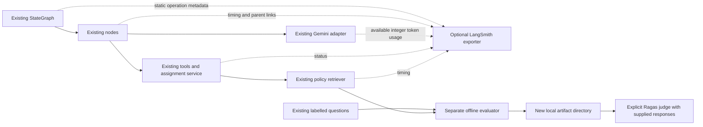

# Observability and offline policy evaluation

LangSmith adds optional operational visibility around the existing agent. Ragas is
a separate policy evaluation command. The StateGraph nodes, routing, assignment
authorization, human consent, transaction implementation, idempotency, existing
labels and grading expectations retain their existing behavior.

## Architecture and privacy

`observability.py` wraps compiled graph execution and existing node functions.
`intent.invoke_observed` covers both intent extraction and the native tool-calling
Gemini loop. Retrieval spans cover preparation, hybrid ranking and search; tool
spans cover native reads and the host's existing assignment invocation. The wrapper
delegates checkpoint inspection and supports sync/async invocation and streaming.



The exporter builds new records with an allowlist: static operation name/type,
random span/parent/trace IDs, start/end times, duration, status and nonnegative
integer input/output/total token counts when supplied by the adapter. Unknown
token counts remain absent. Errors use the fixed string `operation_failed`;
interrupts are recorded as interruptions. Business failures returned by tools
mark their spans as errors without copying error messages.

No graph state, message text, model prose, tool arguments/results, CRM fields or
identifiers, actor IDs, approval bindings, consent signatures, request keys,
correlation IDs, exception strings, tracebacks or environment snapshots are
serialized to LangSmith. Graph calls/resumes receive separate trace roots; private
thread IDs are not exported to link them. Nested spans show actual execution paths.
The SDK uses its API key for authentication; credentials never enter trace records.

Native LangChain/LangGraph payload tracing is disabled in the execution scope,
including before the first graph node, even if `LANGSMITH_TRACING=true` is set in
the shell. Only the explicit content-free exporter sends records. SDK runtime
metadata injection is also disabled. This intentionally gives up prompt/response
inspection in hosted traces to protect private state. Application-controlled
configuration such as project name and endpoint must also contain no private data.

Existing `Trace.emit`, structured observers, redaction, observer error accounting,
evaluation trajectories and local artifacts retain their existing behavior.
They are not forwarded to LangSmith. The exporter does not use the local trace's
broader field allowlist. Export failures cannot alter application outcomes or
evaluation grades. Records use SDK background batching; remote delivery is best
effort and has not been tested against a hosted account in this change.

## Dependencies and configuration

There is no new service, vector database or agent framework. LangSmith is already
a transitive dependency of the installed LangChain stack; the optional
`observability` extra records the supported SDK range (`>=0.12,<1`). The optional
`ragas` extra uses `ragas>=0.4.3,<0.5`, `instructor>=1.17,<2` and the modern
collections API. The Instructor bound avoids an obsolete version selected by
Ragas' unconstrained transitive requirement. The extra also pins
`langchain-community>=0.4.1,<0.4.2`: Ragas 0.4.3 imports a legacy Vertex adapter
that community 0.4.2 removed, even when evaluating Gemini through our adapter.
Ragas brings
its own evaluation dependencies, including datasets, instructor and LangChain
community integrations. None are required for normal agent use or offline
retrieval preparation. Do not install Ragas' `all` extra for this pipeline.

```powershell
.\.venv\Scripts\python.exe -m pip --cache-dir .cache/pip install -e '.[observability]'
# A separate local environment for optional evaluation dependencies:
python -m venv .venv-ragas
.\.venv-ragas\Scripts\python.exe -m pip --cache-dir .cache/pip install -e '.[ragas,dev]'
```

Keep optional judging dependencies separate from the working app environment.
The resolver check found incompatible shared-package requirements: current
Instructor constrains jiter/rich versions, and datasets constrains fsspec. In the
SDK validation environment these resolved to Instructor 1.17.0, OpenAI 2.54.0,
jiter 0.14.0, rich 14.3.4 and fsspec 2026.7.0. The application environment was
left unchanged. A local virtual environment needs no new service. Run judging
with its Python executable; preparation can continue using the application Python.

Set these in the existing `.env` or process environment; existing environment
values take precedence. The CLI loads `.env` as before.

```dotenv
SALES_COPILOT_LANGSMITH=true
LANGSMITH_API_KEY=<your key>
LANGSMITH_PROJECT=sales-copilot
# Optional regional/self-hosted endpoint:
# LANGSMITH_ENDPOINT=https://api.smith.langchain.com
```

Missing credentials, an unset/false application flag, or exporter initialization
failure makes export a no-op. The application still works. Verification required
no credentials or provider calls. SDK tests use fake credentials and a captured
transport. Generic LangSmith environment flags alone do not opt the
Copilot into export.

## Offline preparation

Run from the project root, using policy models already downloaded by the existing
`prepare-policies` command. Preparation explicitly uses `local_files_only=True`;
missing cached weights cause failure rather than a download or paid fallback.
All evaluation telemetry export is suppressed even in a tracing-enabled process.

```powershell
.\.venv\Scripts\python.exe -m sales_copilot.rag_eval prepare
```

Each invocation creates a UUID directory under `docs/rag_runs`. You may supply a
new `--run-id`; reusing an existing directory fails before evaluation. Existing
evaluation files are never overwritten. The files are:

- `retrieval.json`: output of the original retrieval evaluator, including all
  four ranking stages, existing labels, canonical citations and model versions.
- `samples.json`: exact labelled questions and canonical retrieved contexts;
  no generated answer, reference answer or ground truth is inserted.
- `report.json`: deterministic aggregates, dataset/corpus fingerprints, negative
  abstentions and explicit skipped statuses for unexecuted judge metrics.

The existing questions supply **policy-ID relevance labels**, not reference
answers or section-level relevance labels. Recall@3 and MRR@5 keep the existing
passage-position definitions, including duplicate chunks of one policy occupying
positions. Aggregates exclude the three negative questions; their abstentions
are reported separately. These are deterministic metrics of the actual cached
retrieval models; they are not described as Ragas LLM judgments.

## Explicit Ragas judging

There is no automatic answer-generation step. Supply responses actually produced
against the saved questions and contexts. Create a separate JSON file with this
structure, using the real dataset hash/citations from the prepared artifacts:

```json
{
  "samples_sha256": "<samples_sha256 from prepare report.json>",
  "responses": [
    {
      "id": "Q01",
      "response": "<actual recorded response>",
      "source": "<model/run or authored-response provenance>",
      "retrieved_citations": ["<exact saved citation, in saved order>"]
    }
  ]
}
```

Use only responses for this fictional corpus. The dataset hash and ordered
citations bind each response to its exact prepared snapshot. Unknown/duplicate
question IDs, missing provenance, changed questions, noncanonical contexts,
stale corpus fingerprints and mismatched snapshots are rejected before the judge
factory is imported. A hash binds an artifact; it is not proof that its response
was produced by a particular model. Keep source artifacts for auditing.

The provided `sales_copilot.rag_judges:gemini` factory requires an explicit
`RAGAS_JUDGE_MODEL` and uses the existing Gemini integration with structured
output. A small adapter implements Ragas' modern LLM interface; embeddings reuse
the existing cached MiniLM model locally. There is no embedding API charge or
extra Gemini provider wrapper. Set Google credentials as for the existing agent.
This command **may incur Gemini costs** and was not run during verification:

```powershell
$env:RAGAS_JUDGE_MODEL='<Gemini model available to your account>'
.\.venv-ragas\Scripts\python.exe -m sales_copilot.rag_eval judge `
  --prepared docs/rag_runs/<prepared-run> `
  --responses evaluation/<recorded-responses>.json `
  --judge-factory sales_copilot.rag_judges:gemini `
  --allow-llm-judge
```

A trusted alternative `module:function` can return `(llm, embeddings)` implementing
Ragas' `InstructorBaseRagasLLM` and `BaseRagasEmbedding` interfaces, including local
implementations. There are no implicit provider/model defaults. Factory code is
trusted executable Python and must respect the same data boundary. Ragas product
analytics and native LangSmith tracing are disabled during this pipeline.

| Metric | Method and prerequisites |
| --- | --- |
| Faithfulness | Ragas `Faithfulness`; judge checks recorded response claims against retrieved contexts. No reference answer needed. |
| Response relevancy | Ragas `AnswerRelevancy`; judge-generated questions plus explicitly supplied embeddings. Evaluates relevance, not correctness. |
| Context utilization | Ragas `ContextUtilization`; response-relative context usefulness/ranking. This is not labelled retrieval recall. |
| Answer correctness / reference-based context recall | Skipped: existing labels have no reference answers. |

Each question/metric records `measured`, `skipped` or `error`. Missing responses
are skipped; grounding/utilization are skipped for empty contexts. Exceptions,
timeouts and nonfinite scores are errors with null values, never fabricated zero
scores. Per-metric means include only executed finite scores, with separate
measured/skipped/error denominators. No cross-metric composite score is invented.
`--metric-timeout` defaults to 60 seconds per metric; each metric can make several
judge calls. The built-in Gemini adapter retains the existing single-attempt SDK
setting. Setup failures write a sanitized `failure.json`; interruptions leave
`run.json` marked started. Neither produces a completed score report. Rerun into
a new directory.

## Actual verification results (2026-10-26)

No paid API calls or hosted LangSmith requests were made. No CRM data files or
older evaluation artifacts were edited. Observability tests cover missing opt-in,
metadata-only SDK payloads, native tracing suppression, integer usage filtering,
error sanitization, nested paths, streaming, async invocation, approval/resume and
commit behavior when telemetry fails.

The full test command was `.\.venv\Scripts\python.exe -m pytest`: **414 passed,
1 skipped** (the optional Ragas SDK module is absent from the application environment).
The isolated Ragas 0.4.3 environment ran `tests/test_ragas_sdk.py` and
`tests/test_rag_eval.py`: **19 passed**, including real metric implementations
with typed judge/embedding doubles and the built-in Gemini factory contract.
Its compatibility packages were installed under `.cache/ragas-sdk` and
`.cache/ragas-compat` for this check; application packages were unchanged.
These checks validate SDK plumbing, not the accuracy of a live judge.
The scripted benchmark ran with `--trials 2`: **60/60 passing scenario trials**,
190/190 valid observed citations, zero unnecessary tool calls and zero provider
adapter invocations. Its deliberately injected failures remain part of the
existing scenario expectations. Scripted token usage is unknown, not zero.
See [benchmark report](stage4_runs/langsmith-ragas-scripted-final-20261026/report.md).

Cached local retrieval ran against **28 positive and 3 negative queries**, using
the real MiniLM embedding and cross-encoder models:

| Stage | Recall@3 | MRR@5 |
| --- | ---: | ---: |
| BM25 | 0.928571 | 0.971429 |
| Dense | 0.982143 | 0.964286 |
| Fused | 0.982143 | 1.000000 |
| Reranked | 0.946429 | 0.982143 |

Negative abstentions: **3/3**. See the immutable
[retrieval artifact](rag_runs/langsmith-ragas-offline-20261026/retrieval.json) and
[pipeline report](rag_runs/langsmith-ragas-offline-20261026/report.json).
Faithfulness, response relevancy and context utilization are **not measured**;
their artifacts say skipped. Live Gemini reliability and hosted LangSmith delivery
are also unmeasured. Test-double scores used to exercise the judging pipeline are
unit-test fixtures, not benchmark results.

The integration follows the primary SDK references for
[LangSmith run creation](https://reference.langchain.com/python/langsmith/client/Client/create_run),
[Ragas faithfulness](https://docs.ragas.io/en/latest/concepts/metrics/available_metrics/faithfulness/),
[response relevancy](https://docs.ragas.io/en/latest/concepts/metrics/available_metrics/answer_relevance/)
and [context utilization](https://docs.ragas.io/en/latest/concepts/metrics/available_metrics/context_precision/).
