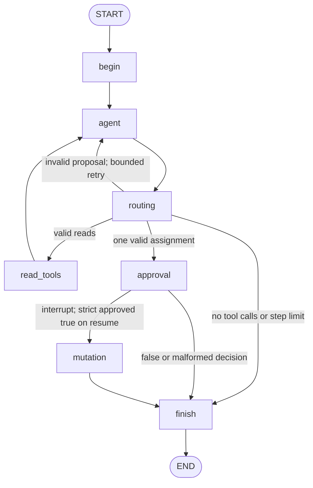

# How Stage 1 works

The LLM decides which CRM tool to request from natural language. Python code decides which operations may execute. The model never receives a database connection or an approval capability.

## State

`State` is a `TypedDict`. `messages` uses LangGraph's `add_messages` reducer, preserving `HumanMessage`, `AIMessage` and `ToolMessage` history across turns. A model's native tool calls live on `AIMessage.tool_calls`, including tool name, arguments and call ID. Each `ToolMessage` uses that same call ID so the next model invocation can interpret the result.

Other state fields are per-turn `steps`, validated `read_calls`, `pending_action`, `pending_call_id`, `approved_action`, `route`, structured `results` (including executed read arguments), original `final_ai_message`, `answer_source` and the final `answer`. `begin` resets these per-turn fields while retaining messages. Graph input accepts messages only; the `Copilot` host wrapper additionally refuses new chat messages while any run is pending.

`pending_action` is an unapproved `AssignLead` payload. `approved_action` is a separate application-created `ApprovedAssignment` envelope containing that exact payload, the originating tool-call ID and strict boolean approval. Tool argument schemas have no approval field and reject extra fields.

## Nodes and edges



1. `begin` starts a new turn with no pending or approved action.
2. `agent` calls a real LangChain chat model bound to all three native tool schemas. The system prompt includes the four agents so the model can resolve agent IDs without another tool. There is no keyword-based routing of user text.
3. `routing` checks structured tool calls against Pydantic schemas. Unknown tools, invalid JSON, duplicate/missing call IDs, more than eight calls, extra arguments, and mixed/multiple write batches fail closed. Valid reads route to `read_tools`; exactly one valid assignment becomes the pending action and routes to `approval`.
4. `read_tools` has an allowlist containing **only** search and details. It uses parameterized SQL on SQLite connections opened with `mode=ro`, adds results as `ToolMessage`s, and returns to the model. Several reads can execute in one batch.
5. `approval` calls `interrupt()` with the exact pending action. No database write happens before or inside the interrupt. Resuming restarts this node from the top, which is safe because its pre-interrupt work only emits a trace. A strictly validated `{"approved": true}` decision constructs the approved envelope. False, string booleans, numbers, missing fields, null, unexpected extra fields, and other shapes deny the action and finish.
6. `mutation` revalidates the envelope, compares its action and call ID with the pending action, and passes only that approved object to the repository. It then clears the pending/approved state and ends the turn through `finish`.
7. `finish` uses `presentation.py` to build a readable user-visible answer from structured tool results, including the actual filters, lead fields and error codes. The original final model message remains available as `final_ai_message`; `answer_source` and trace metadata identify how the displayed answer was produced. The CLI prints `answer`, with no ToolMessage fallback. Even a model message saying “assignment succeeded” cannot produce a user-visible success without SQLite confirmation.

After invalid tool proposals the agent can try again, bounded by the model step counter. The counter is checkpointed, survives a pause/resume, and resets only at the next user turn. A graph recursion limit provides a second bound. Assignment completion/rejection goes straight to `finish`, preventing an automatic repeat proposal after the decision.

## Typed tool calls

`make_tools` creates LangChain tools with Pydantic argument schemas. `model.bind_tools(tools)` sends those schemas to the provider. A typical model reply contains:

```python
AIMessage(content="", tool_calls=[{
    "name": "assign_lead",
    "args": {"lead_id": 1, "assignee_id": 2, "request_key": "demo-1-to-2"},
    "id": "call-1",
    "type": "tool_call",
}])
```

The `assign_lead` LangChain tool is a proposal schema with a body that raises if invoked. It is never placed in a generic tool executor. Only the `mutation` node can call the actual repository mutation method. Pydantic models use strict validation, positive IDs, forbidden extra fields and a bounded request key; no model-supplied `approved` argument is accepted.

Search distinguishes an omitted/null `owner_id` (no owner filter) from `unassigned_only=true` (`owner_id IS NULL`). These ownership filters cannot conflict. The original 20 rows all had owners, and the original schema prohibited null owners. The additive seed upgrade makes `owner_id` nullable, preserves the original rows/indexes/triggers in one transaction and adds a realistic fictional Chennai fixture only when needed. A seed rerun never resets that fixture after assignment. The corrected dataset has 21 leads; SQL filters still select actual records. A left join keeps unassigned leads visible in details, and removing the old 20-row limit avoids silently hiding the additional record.

The agent preserves each original model `AIMessage`, including Gemini thought-signature metadata, when sending tool results back to the model. `ToolMessage` carries both the matching call ID and tool name. If a model invocation raises, `errors.py` converts it to a fixed diagnostic code and safe HTTP status/hint without using raw exception text. A failure message routes through `finish`, preserving earlier read results and allowing the next chat turn; the failed response cannot create a pending assignment.

An actual live inspection confirmed that Gemini generated a final text `AIMessage` after the empty search, but the old `finish` node discarded it and explicitly JSON-serialized the results. This was application formatting, not a CLI fallback or a missing Gemini response. The current conversational renderer preserves the original safety boundary while showing ordinary prose. Details, before/after grouped records and live evidence are in [stage1_inspection.md](stage1_inspection.md).

## Checkpointing and resume

The compiled graph uses `InMemorySaver`. The CLI generates a UUID thread ID at startup unless one is supplied with `--thread-id`, then preserves it for all chat and resume calls in that process.

```python
paused = copilot.chat("Assign lead 1 to agent 2 with request key demo-1-to-2")
payload = paused["__interrupt__"][0].value
# A trusted host obtains the separate user's decision, then internally invokes:
resumed = copilot.graph.invoke(
    Command(resume={"approved": True}),
    copilot.config,  # includes the SAME configurable.thread_id
)
# Prefer copilot.resume({"approved": True}) in application code.
```

The saved state includes the pending action and messages. A different thread ID selects a different checkpoint and cannot resume this action. Reusing an ID in a new process does not restore the old in-memory checkpoint. `Copilot.resume` refuses calls when no interrupt is pending; `Copilot.chat` refuses new input while a run is incomplete.

The wrapper also validates decision shapes before passing them to `Command`. LangGraph interprets an empty dictionary as an interrupt-ID mapping and `None` as no resume value, so malformed decisions are normalized to a nonempty invalid sentinel. The approval node rejects that sentinel without executing a write. It independently validates decisions again after the interrupt returns.

## Mutation safety and confirmation

`CRM.assign_lead` accepts only `ApprovedAssignment`, revalidates it, checks that the lead and assignee exist, updates the owner and UTC timestamp with parameterized SQL, checks the affected row count, and reads back the saved owner inside a transaction. A result with `ok=true` is returned only after the transaction context commits successfully. The user-visible success line is generated from that result. Rejection leaves all lead columns, including timestamps, unchanged. Database errors produce an error result instead of a success claim.

SQLite safeguards are intentionally minimal: foreign keys, simple value constraints, parameterized queries, read-only read connections and a transaction. The request key is carried in the structured action and result but is not an idempotency key in Stage 1. There are no full permission policies, durable approval records, concurrency safeguards or crash/replay guarantees.

The Python host and its graph/checkpointer are trusted. A Pydantic envelope is not a security boundary against arbitrary code running in the same process. Only chat messages and separately collected decisions should be accepted from callers. A later service must not expose arbitrary graph state edits or repository mutation calls.

## Traces and tests

The local JSON trace formatter logs each node and validated selected tool, arguments, decision and result. It redacts lead/contact names, companies, emails, owner names and request keys. It does not log raw model prompts or responses. The approval prompt deliberately shows the action to the local user; fictional read data is delivered to the model and local user as part of the CRM workflow.

Tests use a scripted chat-model double for deterministic tool selection but exercise the actual compiled graph, checkpointing, interrupt/resume and SQLite. Complete row snapshots verify no change before approval and after denial. Other tests cover malformed decisions and proposals, unsupported tools, missing records, direct dispatch protection, error reporting, traces, loop bounds and preserved conversation state. Live API connectivity and model quality require separately running the CLI with your credentials.

## APIs checked before implementation

The implementation follows the current official Python documentation checked on 2026-10-25:

- [LangGraph Graph API](https://docs.langchain.com/oss/python/langgraph/graph-api): custom `StateGraph`, message reducers, nodes, conditional edges and compilation.
- [LangGraph interrupts](https://docs.langchain.com/oss/python/langgraph/interrupts): `interrupt`, `Command(resume=...)`, checkpointers, stable `thread_id`, node restart semantics and default `invoke()` interrupt output.
- [LangChain models and tool calling](https://docs.langchain.com/oss/python/langchain/models#tool-calling): `bind_tools`, native calls and correlated tool results.

The implementation uses the supported synchronous `invoke()` interface and `__interrupt__` output. It validates resume decisions in application code and does not depend on newer optional interrupt response-schema or event-streaming APIs.
