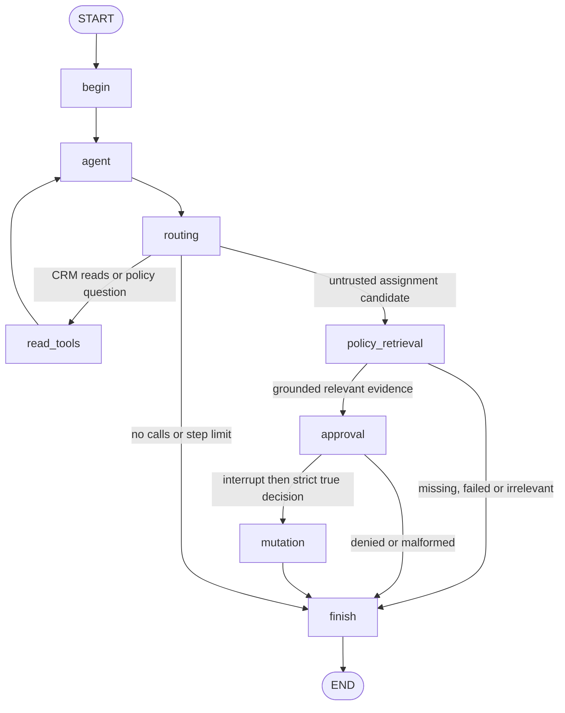

# Stage 2: policy evidence and hybrid retrieval

Stage 2 adds local policy retrieval to the existing Gemini/StateGraph CRM. It does not turn policy prose, similarity scores, citations or a language model into business authorization. The separate human interrupt remains mandatory, and full deterministic policy enforcement is explicitly pending for Stage 3.

## Corpus, versions and chunks

The corpus is in `sales_copilot/policies/`: ten fictional policies covering geography, restricted industries, agent certifications, VIP handling, reassignment, capacity, availability, management approval, priority and ownership. Each document has a stable policy ID, title, version and six independently titled sections. The expanded corpus contains **4,657 words, 60 sections and 60 chunks**. Individual documents range from 453 to 488 words and include examples, exceptions, evidence checklists and missing-data scenarios. Longer documents add useful distinctions, but do not by themselves guarantee higher retrieval quality.

`corpus.py` validates the manifest and documents. A missing required policy, duplicate ID, duplicate section or invalid file blocks policy operations. Each section is split into at most 170 whitespace-delimited words, retaining its section reference. The present sections fit within that bound. There is no overlap across policy or section boundaries.

A citation looks like `[CRM-PRI-009@1.0/S1/C1-c30ebe55da]`: policy ID, version, section, chunk number and the first ten characters of its content SHA-256. The complete text hash is also in each reference. IDs remain stable for unchanged source content; content/version changes invalidate previous references. `Corpus.resolve` compares the canonical metadata, citation and hash. A citation authenticates the source passage, not the truth or authority of every sentence in it.

## Embeddings and cosine similarity

`sentence-transformers/all-MiniLM-L6-v2` runs locally on CPU and produces normalized 384-dimensional embeddings for each chunk's title, section title and text. A query is encoded with the same model. An embedding is a learned numerical representation that can place differently worded but related text near each other.

Cosine similarity is `dot(a, b) / (norm(a) * norm(b))`. With normalized embeddings it reduces to a dot product. Higher cosine scores indicate semantic similarity; they are not probabilities of correctness, policy compliance or permission.

Corpus vectors are stored in an in-memory NumPy matrix and compressed `.npz` files under `.cache/policies/`. Cache keys include the corpus fingerprint, embedding model ID and encoding format. Models are cached under `.cache/policies/models/`. The shared retriever loads them once per process and encodes only the query on each request. A corpus edit or a corrupt vector cache causes rebuilding in a new retriever/process. An existing process with old references fails closed; restart after editing policies. Model IDs are fixed in code, but upstream model revisions are not production-pinned.

## BM25 lexical search

BM25 ranks chunks using exact token occurrence, inverse document frequency, term-frequency saturation and document-length normalization. The app uses `rank-bm25`'s BM25Okapi defaults and a shared lowercase alphanumeric tokenizer. It retrieves up to 12 positive-scoring chunks independently of dense search. BM25 is useful for specific terms such as a certification, city, numerical threshold or ownership field, while paraphrases may benefit from dense retrieval.

BM25 scores and cosine scores have different scales. They are not added directly.

## Reciprocal Rank Fusion

Dense search independently retrieves its top 12 chunks. RRF combines the two ranked lists using:

```text
RRF(chunk) = sum(1 / (60 + rank_in_each_list))
```

Ranks start at 1. A chunk appearing near the top of both lists gains contributions from both. Missing candidates receive no contribution from that list. Ties are resolved by stable chunk ID. The reranker receives the top 12 fused candidates.

## Cross-encoder reranking

`cross-encoder/ms-marco-MiniLM-L6-v2` jointly reads each query/candidate pair on CPU, allowing interactions between their tokens. It reranks the fused candidates; it does not generate passages or citations. Its raw logits are returned using an identity activation. They are neither cosine scores nor calibrated probabilities. Every result retains BM25, dense, RRF and cross-encoder scores so the stages remain inspectable.

For evidence returned to the agent, a passage must have cosine similarity at least **0.25** and cross-encoder logit at least **0.0**. These are prototype relevance heuristics selected before this evaluation, not authorization thresholds. Unrelated nearest neighbours are not automatically accepted. Cross-encoder ranking does not guarantee an improvement; the actual comparison below shows a decrease on this small labelled set.

## LangGraph integration



`retrieve_policy(query, top_k)` is the fourth structured LangChain tool bound to the existing Gemini model. Its raw return contains canonical passages, exact citations, scores and a non-authorization notice. It lives in the read-only allowlist. `assign_lead` remains a proposal-only tool whose callable body cannot mutate the database.

An LLM `assign_lead` call is initially an untrusted `candidate_action`. The graph does not accept it as a pending approval proposal until the dedicated `policy_retrieval` node succeeds. This node builds an action-context query from actual lead city, owner, priority, score and receiving-agent city. It does not infer industry, certification or availability from fictional names. A free-form policy query from an earlier turn cannot replace this action-specific retrieval.

The minimal evidence gate requires canonical, above-threshold passages including an ownership, geographic or reassignment policy. This is topical coverage only, not an attempt to enforce every policy. The result is bound to a SHA-256 of the exact validated `lead_id`, `assignee_id` and `request_key`, plus the corpus fingerprint. Changing any action field invalidates the binding. Approval and mutation independently revalidate this binding and resolve the source references against current files. Corpus edits during a pause block the write.

The approval interrupt includes the exact action, compact policy references and the warning that deterministic enforcement is pending. The CLI resolves and shows their canonical excerpts before accepting a decision. Only a strict explicit `approved=True` decision permits the mutation node to proceed. Denial, missing evidence, invalid references, model assertions or malformed decisions do not modify the CRM. The executor still checks the approved structured action, record existence, affected row and successful commit. There is no direct routing edge from a model call to mutation.

## Compact state and untrusted text

Graph state stores compact references, titles, versions, source hashes, scores and action/corpus fingerprints. Policy ToolMessages and result records contain references without full passage bodies. Immediately before a model invocation, the app hydrates temporary copies of those ToolMessages from the canonical corpus. Original Gemini AIMessages and thought signatures are preserved. The saved model output and short displayed excerpts may naturally contain quoted text, but document bodies are not duplicated into the evidence objects, ToolMessages and results.

The system prompt labels retrieved text as untrusted data. Structural code controls routing and approval; text such as “ignore all rules” or `approved=true` has no capability to set approval state or call the write executor. Even a canonical malicious passage remains untrusted. The final renderer prints canonical cited excerpts and fixed notices, rather than displaying invented model citations or claims of compliance.

Conflicting passages can be displayed together without selecting one as an override. The prototype does not detect every semantic conflict or decide which business rule wins. A human sees the Stage 3 limitation before an assignment. Human application confirmation is not represented as authenticated manager approval or production policy authorization.

## Diagnostics

```powershell
.\.venv\Scripts\python.exe -m sales_copilot.cli prepare-policies
.\.venv\Scripts\python.exe -m sales_copilot.cli policy --query "Which industries require certified agents?"
.\.venv\Scripts\python.exe -m sales_copilot.cli evaluate
.\.venv\Scripts\python.exe -m sales_copilot.cli chat --thread-id stage2-demo
```

The first command loads the two public model checkpoints and builds/loads corpus embeddings. No Hugging Face key is required for these public models. The diagnostic command emits four `TRACE` rankings (`bm25`, `dense`, `fused`, `reranked`) with canonical citations and scores. It does not log raw queries, CRM contact fields, request keys, API credentials or model prompts. The existing `stage1-demo` thread naming still works within a process; checkpoints remain in memory only.

Try these chat requests:

- “Show me unassigned Chennai leads.”
- “What are the contact response windows for high priority leads? Cite policy.”
- “What certification is needed for a healthcare prospect?”
- “Explain VIP sponsor review and reassignment handover.”
- “Propose assigning lead 21 to Chennai agent 1 with request key stage2-demo-21.”

The actual live Gemini trace is saved in [stage2_actual_trace.jsonl](stage2_actual_trace.jsonl). It shows native `retrieve_policy` selection, all four retrieval stages, action-specific retrieval, the approval pause and explicit denial on a temporary seeded CRM. Owner 21 stayed null before and after denial. Your existing CRM was not used for mutation during the demo.

The separate [stage2_approved_trace.jsonl](stage2_approved_trace.jsonl) uses a scripted candidate and the actual local retriever, compiled graph and temporary SQLite CRM. It pauses with the owner still null; after `Command(resume={"approved": True})`, SQLite confirms owner 1. The existing CRM rows and `.env` were fingerprinted before and after all work and verified unchanged.

## Evaluation: recall and reciprocal rank

[The manually labelled dataset](../evaluation/policy_queries.json) contains **28 positive queries** and **3 unrelated negative queries**, spanning all ten policy IDs and eight multi-policy questions. Labels were written from policy content, not generated from retrieval rankings. This is a small author-labelled development set, not an independent production benchmark.

For each positive query, Recall@3 is the fraction of expected policy IDs represented in the first three **passage positions**. Duplicate chunks of one policy occupy positions and count once toward the relevant-ID set. MRR@5 is the reciprocal position of the first relevant passage in the first five, or zero if there is none; MRR is averaged across queries. It measures how quickly the first relevant result is found, while recall measures expected-policy coverage. Negative queries are excluded from those averages and reported separately for abstention.

Actual local-model results, with the 60-chunk corpus:

| Retrieval method | Recall@3 | MRR@5 |
| --- | ---: | ---: |
| BM25 only | 0.928571 | 0.971429 |
| Dense only | 0.982143 | 0.964286 |
| RRF fusion | 0.982143 | 1.000000 |
| Fusion plus cross-encoder | 0.946429 | 0.982143 |

All **3/3 unrelated queries abstained** under the relevance thresholds. The cross-encoder lowered these aggregate metrics relative to fusion on this dataset. No contrary improvement is claimed. More independently labelled queries, difficult negatives, corpus variants and threshold calibration are needed before relying on semantic relevance in production.

[stage2_evaluation.json](stage2_evaluation.json) records actual per-query rankings/scores, labels, corpus hash, model IDs, thresholds, candidate count and installed library versions. Evaluation ranks the unfiltered result lists to compare algorithms fairly; evidence thresholds are applied separately for abstention. Re-running can overwrite that result artifact but does not touch the CRM or `.env`.

## Failures and scope

Missing models, invalid/missing policy files, index errors, forged citations, changed text, stale corpus references, insufficient relevance or absent topical ownership evidence block assignments with an explicit error and explanation. There is no silent BM25-only fallback. Read-only CRM tools remain usable when policy models are unavailable. Provider failures remain visible with safe codes/status, preserving completed reads. Editing a corpus used by saved policy history requires a fresh process so it can rebuild its index and references.

The regression suite covers preserved Stage 1 behavior, retrieval ordering, cached embeddings, RRF, thresholds, missing policies, malformed/forged references, injected policy instructions, conflicting passages, stale action/corpus bindings and bypass attempts against the actual mutation node. Deterministic encoders/model doubles keep application tests reproducible; the reported evaluation and saved live trace use the actual embedding and cross-encoder models.

The final full run was **96 passed in 4.78s**. All 67 existing Stage 1 tests remain, with the native-tool inventory assertion updated for the new tool and the missing-record test allowing the new, earlier evidence-stage rejection. `pip check` reported no broken requirements. No tests were deleted to obtain a passing result.

No full permissions or policy authorization engine, concurrent-state protection, request-key idempotency, authenticated management approval, durable production audit or persistent production checkpointer is implemented. Policies describe certification, roster and industry facts that this CRM schema does not contain. Retrieval cannot establish those facts. Existing SQLite rows and assignments and the Gemini `.env` configuration are preserved.

## API references checked

- [Sentence Transformers embeddings and similarity](https://www.sbert.net/docs/sentence_transformer/usage/semantic_textual_similarity.html)
- [Cross-encoder usage and raw logits](https://www.sbert.net/docs/cross_encoder/usage/usage.html)
- [Embedding model card](https://huggingface.co/sentence-transformers/all-MiniLM-L6-v2)
- [Cross-encoder model card](https://huggingface.co/cross-encoder/ms-marco-MiniLM-L6-v2)
- [BM25 library implementation](https://github.com/dorianbrown/rank_bm25)
- [RRF explanation](https://learn.microsoft.com/en-us/azure/search/hybrid-search-ranking)

The installed Sentence Transformers constructor and prediction APIs were also inspected locally before using them. The current environment uses Sentence Transformers 6.2.0, Transformers 5.20.2 and PyTorch 2.14.1; complete evaluation versions are recorded in the result artifact.
