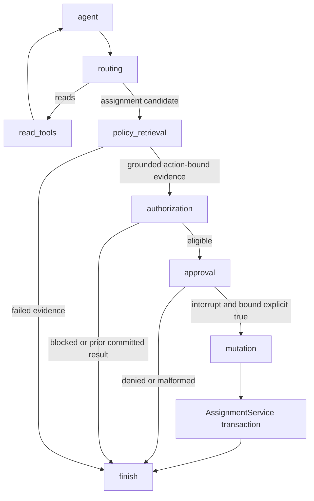

# Stage 3: secure first-time assignment within a fictional local CRM

Stage 3 supports **first assignment of a currently unassigned, active lead**. It does not support reassignment, unchanged-owner requests, management exceptions or capacity overrides. Existing records and owners are preserved. The ordinary ceiling remains **25 active leads**, as explicitly confirmed during implementation; the requested absolute ceiling of 50 does not relax the stricter existing policy.

## Authorization boundary

`AssignmentService` is the authoritative owner-write backend. `CRM.assign_lead` is now a compatibility facade that delegates to it; a Pydantic `ApprovedAssignment` object alone grants nothing. The native `assign_lead` tool remains proposal-only and cannot mutate SQLite. All graph writes and explicit retries use the same service.

The service requires three independent things: structured business eligibility, an explicitly provisioned actor with first-assignment permission, and a signed consent capability bound to the exact action. Retrieved prose, similarity scores, valid citations, model reasoning and the word “approve” in chat cannot satisfy authorization. Human confirmation cannot waive an eligibility failure.

The trusted Python host supplies actor identity. There is **no production authentication**. The CLI starts without an actor by default: reads work and writes fail closed. `setup-demo-identity` explicitly provisions `demo-dispatcher` with `enabled=1`, `can_assign=1` and `simulated=1`. Passing `--demo-actor` explicitly selects that fictional identity and prints its simulated status. It grants no manager role or override. Repeating setup does not restore revoked permissions. Do not expose actor selection, the graph/checkpointer, signer methods, database credentials or Python state editing to untrusted remote callers.

## Additive migration and trustworthy facts

`migrate_database` uses one transactional, repeatable migration. It creates side tables rather than changing the columns or contents of `leads` and `agents`:

| Table | Purpose |
| --- | --- |
| `crm_actors` | Explicit identity, enabled flag, first-assignment permission, simulated flag, provisioning source |
| `lead_intake` | Verified industry, strategic designation, buying-office/territory confirmation, compliance review expiry, verification date and source |
| `agent_roster` | Availability and expected first-contact-window attestation, validity deadline and source |
| `agent_certifications` | Industry scope, scheme, issuer, validity interval, suspension and source |
| `assignment_audit` | Committed action, actor, approval nonce, payload fingerprint, compact policy evidence and rule version |
| `assignment_operations` | Unique request key, canonical payload fingerprint and committed result |
| `crm_migrations` | Applied migration version |

Migration creates **no actor, permission, intake fact, certificate or availability claim**. Unknown metadata blocks assignment. Sources are explicit records authored by a trusted local operator, not inferred from company/agent names or chat. This prototype does not verify an external certification registry or roster provider.

`demo-db --db <new-path>` exclusively creates a separate new database, authors fictional retail intake and seven-day roster attestations, and explicitly provisions the simulated dispatcher. It refuses an existing path. The fixture's assertions cover the next two-business-day first-contact window; they are authored fictional facts, not findings about the existing CRM. It does not create certification or management exception records. Demo roster data eventually expires.

The existing CRM was backed up to `data/crm.before_stage3.20261025T141027.sqlite3`, then migrated. Its 21 lead rows and four agent rows were compared before and after: all values, owners and timestamps matched. No unassigned lead exists in that database at inspection time; lead 21 was already owned and was not reset. The new business/identity tables were left empty. SQLite integrity and foreign-key checks passed. `.env` and the Gemini model adapter were not changed.

## Exact policy-to-rule mapping

The application implements an explicit, reviewed rule set (`stage3-first-assignment-v1`). It pins the entire current canonical corpus fingerprint `64a7f402e0be29c2c4b389fd1e0bc9d5f42a57ea31af9ade702e34b42f629c7e`. Missing or changed policy files block writes until a developer reviews the mapping and deliberately updates its version/fingerprint. No runtime language model translates policy text into executable rules. Retrieval remains independently useful for policy Q&A after an editorial change, but cannot enable writes against unreviewed rules.

All references below are to policy version **1.0**. The corpus was not edited for Stage 3, so its Stage 2 evaluation remains a historical evaluation of the same passages.

| Policy and sections | Structured enforcement / deliberately unsupported case |
| --- | --- |
| `CRM-OWN-010` S1–S4, S6 | Lead and receiving agent must exist; `owner_id` must be null; action-specific canonical evidence and separate explicit consent are required; success follows committed SQLite confirmation only. Actor permission is an additional Stage 3 application restriction, not a role inferred from this prose. |
| `CRM-TERR-001` S1–S3, S5–S6 | Verified buying-office/territory confirmation is required; supported lead city must be Chennai, Bangalore or Hyderabad and exactly match the receiving agent's city. Unknown, unresolved, unsupported and cross-city cases block. No territory exception workflow. |
| `CRM-IND-002` S1–S3, S5–S6 | Require sourced, non-future verified intake and an explicit industry from `retail`, `manufacturing`, `general_software`, `healthcare`, `financial_services`, `insurance`, `public_sector`. Unknown or mixed/unreconciled categories block. Restricted categories additionally need an unexpired compliance intake review. This is ordinary intake review, not an industry exception or management override. |
| `CRM-CERT-003` S1–S4 | A restricted prospect requires a matching industry credential with nonempty scheme, issuer and source, a timezone-aware current validity interval and no suspension. Credential expiry must cover the roster's attested contact window. Missing, pending, future, expired, suspended or mismatched credentials block. |
| `CRM-VIP-004` S1–S4 | Score >=90 or explicit strategic designation blocks. An unknown strategic designation also blocks via missing intake. Sponsor/manager approval is outside this stage and cannot be replaced with ordinary CLI confirmation. High priority alone is not VIP. |
| `CRM-REASSIGN-005` S1, S5 | Any non-null owner blocks, including assigning to the same owner. Only first assignment is implemented; no handover or exceptional absence workflow. |
| `CRM-CAP-006` S1–S5 | Count `new`, `contacted`, `qualified` leads owned by the agent; exclude `won` and `lost`. Existing count must be below 25 before adding an active lead. The hard upper bound of 50 is also encoded, but 25 is stricter. No exception. Counts 49/50/51 all reject under the retained policy. |
| `CRM-AVAIL-007` S1, S3, S6 | Require a sourced available roster entry, explicit first-contact-window confirmation and timezone-aware future validity. Missing, stale, on-leave/suspended/unavailable or unconfirmed records block. There is no inferred availability or substitute-owner workflow. |
| `CRM-MGMT-008` S1–S4 | Cases requiring cross-territory, VIP, capacity or industry exceptions block. Missing facts and policy drift block. No manager identity, approval or override is manufactured from text or ordinary human confirmation. |
| `CRM-PRI-009` S1–S4 | Require a known priority and the sourced roster attestation that the receiving agent can cover the expected contact window. Urgency cannot bypass other rules. No business calendar/deadline calculator exists; the application does not claim to have computed the two-business-hour/day deadlines. |

Closed (`won`/`lost`) unassigned records are conservatively blocked rather than silently reopened. This is an explicit Stage 3 scope restriction. The allowed actor's permission covers any otherwise eligible first assignment, not arbitrary database writes or permissions management.

## Graph, checkpointing and exact consent



The preflight is advisory eligibility review, not a guarantee that business facts will still hold when the user responds. A signed proposal binds the actor, lead, destination agent, operation type, request key, canonical payload fingerprint, unique challenge, 15-minute expiry and compact action-specific evidence. Signatures use a cryptographically random process-local HMAC key; they are neither credentials nor LLM-visible tools. Signatures and consent capabilities are redacted from traces.

The approval node calls `interrupt()` with the action and approval binding. It performs no database writes and holds no transaction or lock. `Command(resume=...)` resumes on the same thread/checkpointer and reruns the node. A raw resume must contain strict boolean `approved=True` plus the exact `actor_id`, `operation_id`, `action_fingerprint` and `challenge_id`. Missing fields, coercions, extra fields, changed bindings and previously confirmed challenges fail closed.

The existing trusted host API `Copilot.resume({"approved": True})` remains: it validates the simple UI decision and binds it to the current interrupt before constructing `Command`. This is a host adapter for an explicitly collected decision, not a bare boolean accepted by the mutation service. There is no direct edge from tool routing to mutation. A forged graph/Pydantic approval cannot supply a valid service signature.

The graph remains bounded to 1–20 configurable model steps (default 8), with a recursion bound. Retrieval state retains compact references. The original Gemini `bind_tools` integration and message handling remain. In-memory checkpoints and signer keys do not survive restart; uncommitted consent cannot be resumed after restart without a fresh review. Committed results are durable and can be looked up safely.

## TOCTOU, BEGIN IMMEDIATE and atomic updates

TOCTOU means *time of check to time of use*: an agent could go on leave, lose permission, gain another lead, lose certification or the lead could acquire an owner between preflight and approval. Therefore the backend repeats all mutable checks after acquiring the SQLite writer transaction, including actor permission, current ownership, industry, certification, roster, capacity, VIP/territory restrictions and current rule/evidence binding.

The short write sequence is:

1. Validate the signed consent and exact action before opening a write transaction.
2. Set a bounded SQLite busy timeout (default 1,000 ms) and issue `BEGIN IMMEDIATE`.
3. Check current actor permission; resolve a matching committed key or reject a payload mismatch.
4. For an uncompleted operation, reject expired/replayed consent, revalidate evidence and all rules.
5. Execute the parameterized conditional update, check exactly one affected row, and read back the owner and timestamp.
6. Insert the audit event and completed operation result in the same transaction.
7. `COMMIT`, then return `success`. Any pre-commit failure rolls back all effects.

```sql
UPDATE leads SET owner_id = ?, updated_at = ?
WHERE id = ? AND owner_id IS NULL;
```

SQLite permits only one writer at a time. `BEGIN IMMEDIATE` obtains the writer reservation before the capacity query, so two competing first assignments cannot both observe the final free capacity slot and commit. The second sees the first commit and rechecks the count. The ownership condition additionally prevents overwriting an already assigned lead. This uses separate SQLite connections with ordinary isolation, no shared-cache dirty reads and no transaction held during human interaction. See [SQLite transactions](https://www.sqlite.org/lang_transaction.html) and [SQLite isolation](https://www.sqlite.org/isolation.html).

There is no network call, model inference, embedding computation or user input inside the transaction. Canonical policy validation only reads local files. Lock contention or busy COMMIT returns `temporary_failure` with `sqlite_busy`; there is no automatic retry loop. A real SQLite busy-COMMIT regression test verifies owner, timestamp, audit and idempotency writes all roll back.

## Idempotency, audit and safe retries

Each new user intent gets a host-generated UUID. The model's `request_key` is replaced. A client explicitly retrying an intent must reuse its original operation ID; it must not describe the same operation as a fresh chat intent and expect deduplication across distinct keys.

The canonical SHA-256 payload includes actor, lead, destination agent and `operation_type=first_assignment`; the request key is the unique lookup key. Audit and idempotency rows are durable SQLite records, committed atomically with the owner update. The audit additionally records the unique approval nonce, compact policy evidence and rule version. Failed/denied attempts do not leave a committed success audit entry.

| Case | Verified outcome |
| --- | --- |
| Same key, same committed payload | `already_completed`, returning the stored result; no second update/audit |
| Same key, different actor/lead/agent/type | `conflict`; no writes |
| Different key, lead already owned | `conflict`; no reassignment, even to the same agent |
| Forged, changed, expired or replayed approval for a new effect | `forbidden` |
| Unknown/missing policy prerequisites | `policy_blocked` |
| Active workload at/over 25 | `capacity_exceeded` |
| Busy DB, transactional failure or uncertain response | `temporary_failure`; retry/resolve the original operation |

Re-presenting a valid completed operation is an **idempotent result read**, not approval reuse for a new effect. Current actor permission is still required to read that result. A consumed challenge cannot mint another consent ticket. Changing a ticket, key, actor or destination invalidates its signature.

An exception after COMMIT but before the response returns `commit_response_unknown`, never a fabricated success or a claim of rollback. `/retry` reuses the exact signed consent and key in the same process; the persisted completed row returns `already_completed`. After restart, the `result` command looks up that same key and payload without executing anything. If no committed result exists after restart, obtain a fresh approval using the **original operation ID** via `chat --operation-id ORIGINAL_UUID` (first intent only) or the trusted `Copilot.chat(..., operation_id=original_id)` host API. There is no durable in-flight approval queue. Do not delete audit/idempotency rows while retries may exist.

## Actual runs and validation

The complete recorded run is [stage3_actual_trace.jsonl](stage3_actual_trace.jsonl). Reproduce with:

```powershell
.\.venv\Scripts\python.exe scripts/stage3_trace_demo.py
```

This uses real cached embedding/cross-encoder models, actual policy chunks, the compiled graph, real interrupts and real temporary SQLite databases. **The native-tool-shaped model proposal and approval decisions are scripted test inputs, not a live Gemini response or a real user's authorization.** The script labels them explicitly. It never mutates your existing CRM. It records before/after approval state, all four failure boundaries, same-operation retries and concurrent competition for the last capacity slot.

Selected actual events (60 events in the complete artifact):

```json
{"event":"before_approval","owner_id":null,"audit_count":0,"completed_count":0}
{"event":"scripted_decision","approved":true,"actor_id":"demo-dispatcher"}
{"event":"after_approval","answer":"SQLite confirmed: lead 21 assigned to agent 1.","owner_id":1,"audit_count":1,"completed_count":1}
```

| Injected boundary | First response | Owner / audit / completed after failure | Same-operation retry |
| --- | --- | --- | --- |
| Before mutation | `temporary_failure` | null / 0 / 0 | `success`, then 1 / 1 / 1 |
| After lead update, before audit | `temporary_failure` | null / 0 / 0 | `success`, then 1 / 1 / 1 |
| After audit, before idempotency completion | `temporary_failure` | null / 0 / 0 | `success`, then 1 / 1 / 1 |
| After COMMIT, before response | `temporary_failure`, `commit_response_unknown` | 1 / 1 / 1 | `already_completed`, still 1 / 1 / 1 |

The actual concurrent last-slot run returned `success` for lead 22 and `capacity_exceeded` for the competing lead 21. Final active count was 25 with one audit event. Winner ordering is intentionally not guaranteed. Offline model-loading emitted cached-model and dependency deprecation notices; model loading and the complete run succeeded without a download.

The full suite preserves the 96 Stage 1/2 tests. Existing assignment fixtures were changed from reassignment/cross-city operations to an unassigned lead and eligible same-city agent. Injected/contradictory policy text remains demonstrably untrusted; its changed corpus now also blocks writes pending a rule review. New tests exercise the backend directly without LangGraph, metadata gaps, revoked permissions, certifications, availability, capacity at 24/25/26 and 49/50/51, concurrency, real lock/COMMIT errors, duplicate/mismatched keys, exact approval bindings, forged capabilities and all controlled failure boundaries. The final complete suite passed **177 tests in 57.62 seconds**; `pip check` found no broken requirements.

## Explicit limitations

- No real authentication, SSO, secret distribution or remote security boundary; demo identity selection is simulated.
- No reassignment, manager override, VIP sponsorship workflow, policy exception engine or business-calendar calculation.
- No general-purpose permission engine: this is the explicit finite first-assignment rule set above.
- Trusted operators own metadata accuracy and database/file access; direct arbitrary SQL or hostile code in this process is outside the service boundary. Other writers must use this service for assignment capacity guarantees; external owner/status changes can invalidate workload invariants.
- Audit rows are transactional, not tamper-proof against a database administrator. SQLite is local-file persistence, not distributed coordination or a production availability guarantee.
- Approval checkpoints/signing keys are process-local. Durable committed-result recovery is supported; durable in-flight approval recovery is not.
- The corpus mapping is pinned and must be manually reviewed on edits. Retrieval relevance scores do not become authorization.
- The live Gemini adapter/configuration is preserved and covered by adapter tests; the Stage 3 recorded reliability run uses scripted proposals rather than a live provider call.

Current [LangGraph interrupt documentation](https://docs.langchain.com/oss/python/langgraph/interrupts) was checked during implementation. The synchronous `invoke`/`__interrupt__`, checkpointer, stable `thread_id` and `Command(resume=...)` pattern is retained.
